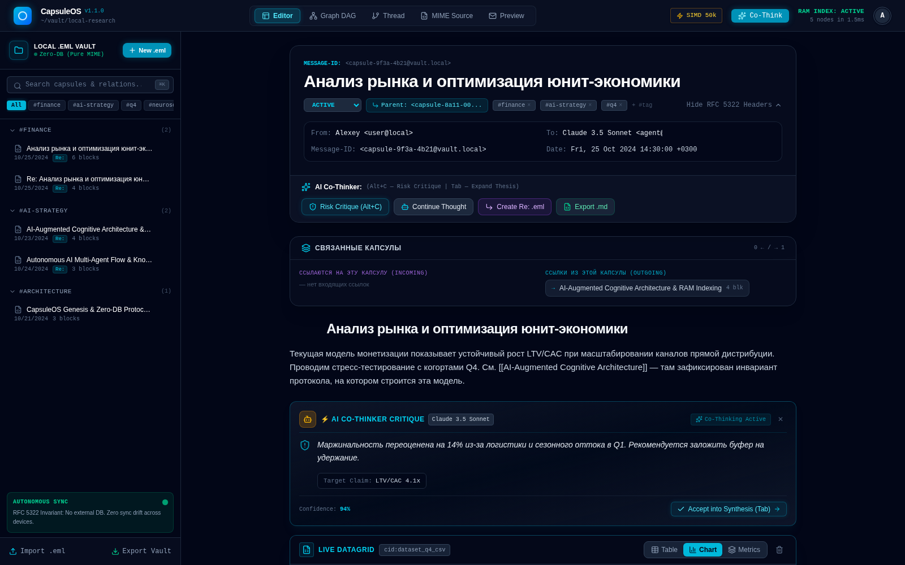
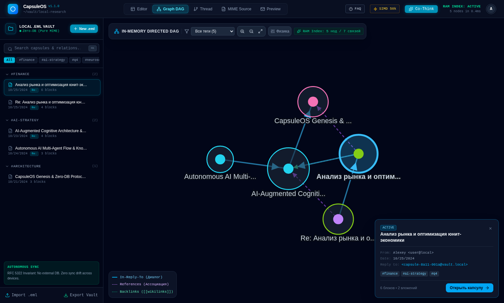

# 🧠 CapsuleOS

**English** · [Русский](README.ru.md)

[](https://github.com/kostyk348/capsuleos/releases)
[](https://github.com/kostyk348/capsuleos/actions/workflows/ci.yml)
[](LICENSE)
[](#build-from-source)

> **A zero-database multimodal workspace and personal knowledge engine.**
> Every note, table, whiteboard and voice memo is a plain **RFC 5322 `.eml` message**.
> No SQL, no document store, no cloud, no lock-in — just files you can open in any mail client.

CapsuleOS is a **native desktop app** (Tauri 2 + Rust + React 19 + TypeScript): a real window, real filesystem, no browser tab, no server process.

| Block canvas editor | Vault graph |
|---|---|
|  |  |

---

## Why

Most note apps keep your knowledge in a proprietary database. Your notes are only yours as long as the app exists and the schema does not change.

CapsuleOS inverts that:

| Conventional PKM | CapsuleOS |
|---|---|
| SQLite / proprietary store | Plain `.eml` files on disk |
| Export = lossy Markdown dump | Export = the file you already have |
| Threads and links are app-internal | `In-Reply-To` / `References` — RFC 5322 semantics |
| Attachments are vendor blobs | Standard MIME parts addressed by `Content-ID` |
| Cloud sync, account, telemetry | Local vault, offline by default |

The whole knowledge base is a **folder of messages** — greppable, diffable, backed up by any tool, readable for decades.

## Features

### 📦 Zero-DB architecture (RFC 5322 EML)
- Each capsule is a full MIME message: `Message-ID`, `In-Reply-To`, `References`, `X-Capsule-Tags`, `X-Capsule-Status`, multipart body.
- Graph store with an **inverted index** — instant full-text search across every capsule.
- Import/export of `.eml` files and `zip` archives, plus a raw-MIME inspector.
- Vault folder is the source of truth: on startup the folder is re-scanned and wins over the JSON snapshot.

### 🧱 Block canvas editor
- Headings, paragraphs, callouts, TODO lists.
- **Live DataGrid** — tables backed by CSV/JSON attachments, with chart and pivot views.
- **Whiteboard** — shapes, sticky notes, mind-map nodes and arrows on a canvas.
- **Code REPL** — run JavaScript blocks in place; JSON blocks are validated.
- **Audio notes** — waveform + transcript stored as capsule blocks.
- **AI opponent** — a critique block that argues against the claim it is attached to.

### 🕸 In-memory graph & threads
- Instant relationship graph (`in_reply_to`, `references`, tags) with satellite previews.
- Thought threads: linear and multi-branch chains of reasoning.

### 🔗 Wikilinks and backlinks
- Type `[[capsule name]]` in any text block, with autocomplete over live capsules.
- Clickable links in preview mode plus a **Related capsules** panel (incoming/outgoing).
- Wikilink edges are drawn in the graph as dashed green links.

### ✍️ Markdown rendering
- `**bold**`, `*italic*`, `` `code` ``, `[link](url)` — live preview inside paragraph, callout and heading blocks.
- Export a capsule to **Markdown** (the `.eml` stays the source of truth).

### 🤖 Offline Co-Thinker
- Deterministic local assistant: `critique`, `continue`, `reply_thread`, `data_insight`.
- No API key, no network calls — the app works fully offline.

## The capsule format

A capsule is ordinary mail. Open it in Thunderbird, mutt or your backup tool:

```eml
Message-ID: <capsule-1755000000000@vault.local>
Subject: Q4 pricing experiment
From: Owner <owner@vault.local>
To: Vault <vault@capsuleos.local>
Date: Tue, 12 Aug 2026 09:14:00 +0000
In-Reply-To: <capsule-root@vault.local>
References: <capsule-root@vault.local>
X-Capsule-Tags: pricing, experiment
X-Capsule-Status: Active
MIME-Version: 1.0
Content-Type: multipart/mixed; boundary="capsule-boundary"

--capsule-boundary
Content-Type: text/html; charset=utf-8

<h1>Q4 pricing experiment</h1>
<p>Fallback HTML view for any mail client.</p>

--capsule-boundary
Content-Type: application/json; name="blocks.json"
Content-Disposition: attachment; filename="blocks.json"
Content-ID: <blocks_json>

[{"id":"blk_1","type":"heading","data":{"level":1,"text":"Q4 pricing experiment"}}]

--capsule-boundary
Content-Type: text/csv; name="cohorts.csv"
Content-Disposition: attachment; filename="cohorts.csv"
Content-ID: <dataset_cohorts_csv>

cohort,users,conversion
Q4-A,1200,0.041

--capsule-boundary--
```

The JSON part is the structured block canvas; the HTML part is a human-readable fallback; extra parts are datasets and attachments addressed by `Content-ID` from DataGrid blocks.

## Download

Prebuilt **Windows x64** installers are attached to every [release](https://github.com/kostyk348/capsuleos/releases/latest):

| File | What it is |
|---|---|
| `CapsuleOS_*_x64_en-US.msi` | Windows Installer package |
| `CapsuleOS_*_x64-setup.exe` | NSIS installer |

- Requires Microsoft Edge **WebView2 Runtime** (preinstalled on Windows 10/11; otherwise [download it](https://developer.microsoft.com/microsoft-edge/webview2/)).
- The installers are currently **unsigned**, so SmartScreen may warn: *More info → Run anyway*.
- `SHA256SUMS.txt` is published next to the installers.

Linux and macOS builds are not shipped yet — build from source below.

## Build from source

**Requirements**

- [Rust](https://rustup.rs/) 1.77.2+ (stable)
- [Node.js](https://nodejs.org/) 20+ with npm
- Linux only: `webkit2gtk-4.1`, `gtk3`, `librsvg2`, `libayatana-appindicator3`, `patchelf`
- Windows: MSVC build tools + WebView2 · macOS: Xcode command line tools

```bash
git clone https://github.com/kostyk348/capsuleos.git
cd capsuleos
npm ci
npm run tauri:dev      # dev window with hot reload
npm run tauri:build    # release installers
```

Output:

- binary — `src-tauri/target/release/capsuleos` (`capsuleos.exe` on Windows)
- bundles — `src-tauri/target/release/bundle/` (`.msi`/`.exe` on Windows, `.deb`/`.rpm`/`.AppImage` on Linux, `.app` on macOS)

### Web mode (no desktop shell)

```bash
npm ci
npm run dev            # Vite dev server on http://localhost:5173
npm run build          # production build into dist/
npm run preview        # serve the build
```

In a plain browser the vault falls back to `localStorage`; native file access is Tauri-only.

## Project layout

```
src/
  engine/mime.ts            build / parse RFC 5322 capsules, attachments, CIDs
  engine/vaultStore.ts      graph store, inverted index, indexes, persistence
  engine/desktopStore.ts    Tauri IPC bridge to the real filesystem
  engine/offlineAi.ts       deterministic offline Co-Thinker
  engine/markdown.tsx       inline markdown renderer
  components/               canvas editor, DataGrid, graph, threads, MIME inspector
  components/blocks/        one component per block type
  types.ts                  capsule / block / graph types
src-tauri/
  src/lib.rs                Rust commands: file IO, dialogs, app data dir
  tauri.conf.json           window, bundle and identifier config
  capabilities/             Tauri permission set
.github/workflows/
  ci.yml                    typecheck + web build, cargo check/fmt/clippy
  release.yml               Windows x64 release (msi + nsis) on tag or dispatch
```

## Data & privacy

Everything is local. Nothing leaves the machine: the app makes no network calls of its own.

| OS | Vault location |
|---|---|
| Windows | `%APPDATA%\com.capsuleos.app\` |
| Linux | `~/.local/share/com.capsuleos.app/` |
| macOS | `~/Library/Application Support/com.capsuleos.app/` |

Inside it: `vault/` with one `.eml` per capsule, and `vault.json` as a cached index snapshot. Delete the folder — you delete the workspace. Copy it — you carry the whole knowledge base.

## Status

`v1.1.0` — desktop app is usable end-to-end. The engine is covered by a vitest suite (MIME round-trip, backlinks, editor helpers). Known rough edges:

- no code signing of installers (Windows SmartScreen warns);
- Python/Rust code cells are stored and versioned but not executed offline (no WASM interpreters bundled);
- capsules are re-scanned from the folder on startup — the in-browser benchmark parses 50k synthetic capsules in ~1.3s, folder scan is slower.

## Contributing

Issues and PRs are welcome — see [CONTRIBUTING.md](CONTRIBUTING.md). Changes are tracked in [CHANGELOG.md](CHANGELOG.md).

## License

[MIT](LICENSE) © CapsuleOS Contributors
