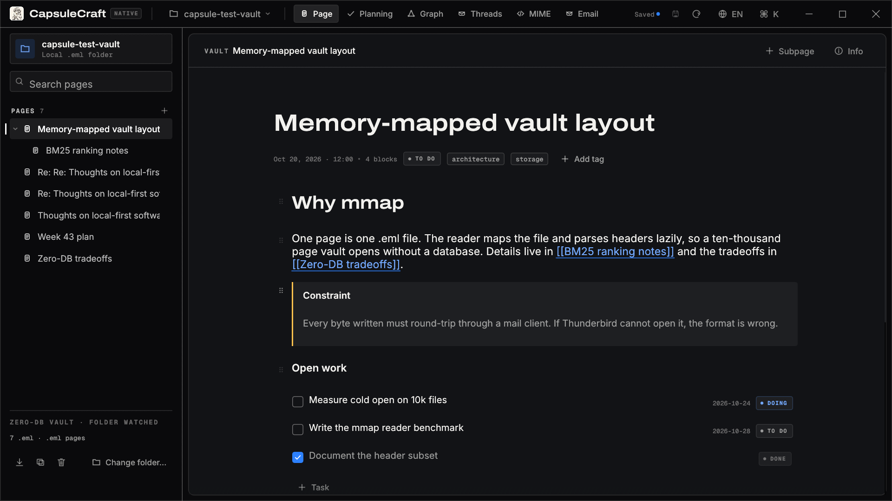
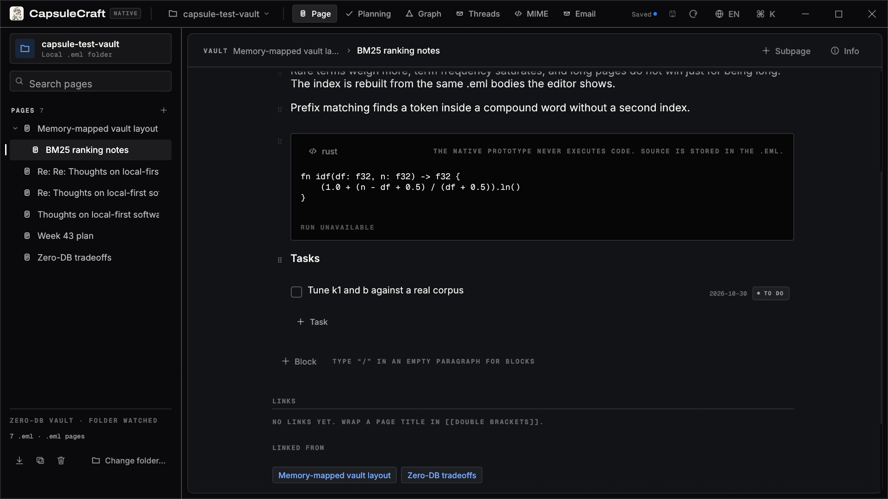
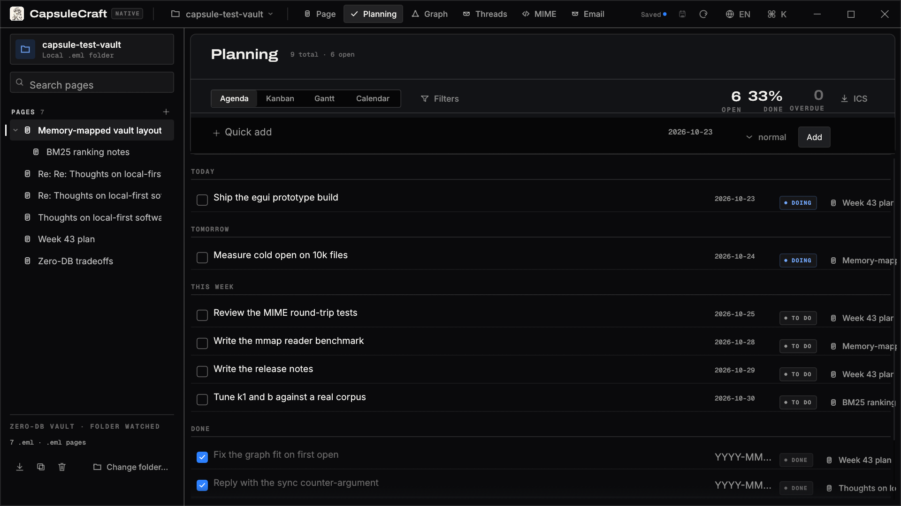
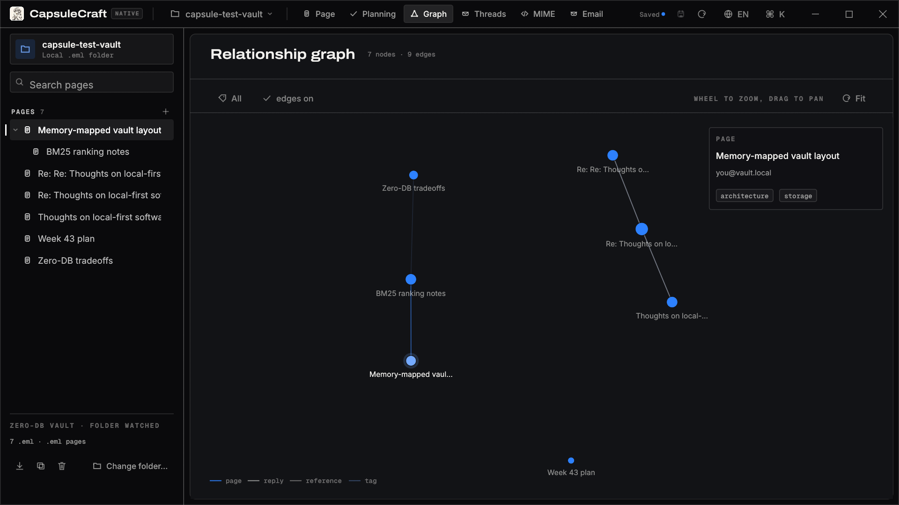
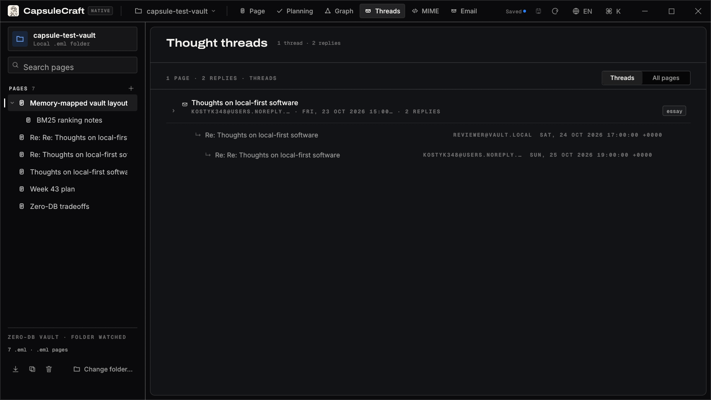
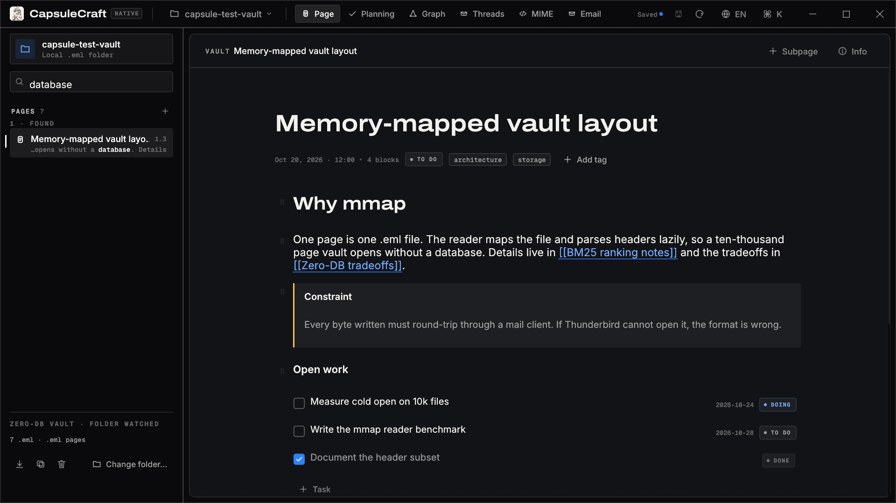
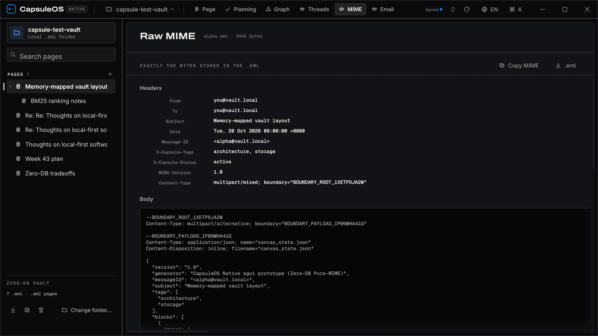
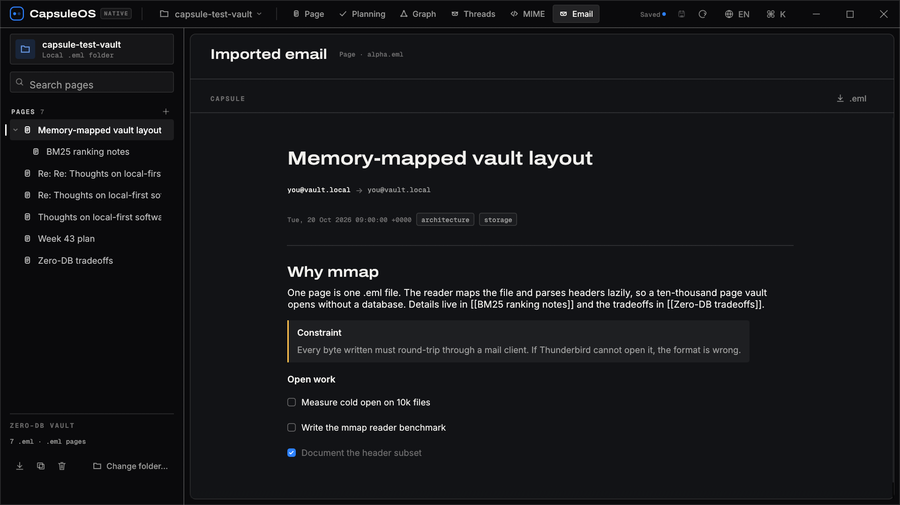

<div align="center">


# CapsuleCraft

### Your knowledge base is a folder of emails.

**A zero-database, multimodal workspace & personal knowledge engine.**
Every note, table, whiteboard and voice memo is a plain **RFC 5322 `.eml` message** —
no SQL, no document store, no cloud, no lock-in. Files you can open in any mail client, grep, diff and back up for decades.

[](https://github.com/kostyk348/CapsuleCraft/releases)
[](https://github.com/kostyk348/CapsuleCraft/actions/workflows/ci.yml)
[](https://github.com/kostyk348/CapsuleCraft/actions/workflows/ci.yml)
[](native/)
[](LICENSE)
[](https://v2.tauri.app/)
[](https://react.dev/)
[](native/)
[](https://github.com/emilk/egui)
[](#-why)
[](#-data--privacy)
[](CONTRIBUTING.md)

**English** · [Русский](README.ru.md)

[Why](#-why) · [Feature tour](#-feature-tour) · [Native shell](#native-egui-prototype-experimental) · [Format](#-the-capsule-format) · [Get started](#-getting-started) · [Architecture](#-architecture) · [Roadmap](#-roadmap)

</div>

---

## 🆕 v1.5 — CapsuleCraft and the native shell

> Same format, same vault, new name and a second, webview-free shell. [Release notes →](docs/releases/v1.5.0.md)

- 🫧 **CapsuleCraft** — the project formerly known as CapsuleOS, with a mascot and a
  full icon set. Format, headers, data folder and message ids are untouched.
- 🖥 **Native egui shell** — a second binary over the same folder, no browser engine:
  wiki links with backlinks, BM25 search, planning, graph, threads, MIME and email.
- 🔗 **Renames keep the wiki alive**, 👀 **folder watching** and a `--snapshot` mode
  that renders these very screenshots from the real app.





<details>
<summary><b>More native screenshots</b> — planning, graph, threads, search, MIME, email</summary>

| | |
|---|---|
|  |  |
|  |  |
|  |  |

</details>

## 🧭 TL;DR

- 📦 **Zero-DB.** One capsule = one `.eml` file on disk. Thunderbird can read your notes. `grep` can search them. `rsync` can sync them.
- 🧱 **Beyond Markdown.** A block canvas editor: headings, callouts, TODOs, live CSV DataGrids with charts, whiteboards, code REPL, voice notes — all inside one MIME container.
- 🤖 **Offline co-thinker.** A deterministic local AI opponent critiques your claims, continues your threads and answers with datasets. No API key, no network.
- ⚡ **Fast.** The real, in-browser benchmark parses **50 000 capsules in ~1.4 s** (~36k files/s) — measured, not marketing.

> Known gaps are listed in [LIMITATIONS.md](LIMITATIONS.md) — roadmap items are never presented as shipped features.

## 🗓 Releases

| Version | Date | Highlights |
|---|---|---|
| [v1.5](docs/releases/v1.5.0.md) | 2026-10-23 | CapsuleCraft rename, mascot icons, native egui shell (wiki links, search, folder watching) |
| [v1.4](docs/releases/v1.4.0.md) | 2026-10-22 | Planning layer, hierarchical pages, email import, task filters |
| [v1.3](docs/releases/v1.3.0.md) | 2026-10-22 | Content-aware offline Co-Thinker, related capsules by tf-idf |
| [v1.2](docs/releases/v1.2.0.md) | 2026-10-22 | BM25-ranked search, Linux installers |
| [v1.1](docs/releases/v1.1.0.md) | 2026-10-22 | Real audio notes, honest benchmark, empty-vault onboarding |
| [v1.0](https://github.com/kostyk348/CapsuleCraft/releases/tag/v1.0.0) | 2026-08-16 | Block canvas, `.eml` vault, graph, threads, Tauri shell |

Full notes live with each release: [GitHub Releases](https://github.com/kostyk348/CapsuleCraft/releases) · [Changelog](CHANGELOG.md).

## ❓ Why

Most note apps keep your knowledge in a proprietary database. Your notes are only yours as long as the app exists and the schema does not change.

CapsuleCraft inverts that:

| Conventional PKM | CapsuleCraft |
|---|---|
| SQLite / proprietary store | Plain `.eml` files on disk |
| Export = lossy Markdown dump | Export = the file you already have |
| Threads and links are app-internal | `In-Reply-To` / `References` — RFC 5322 semantics |
| Attachments are vendor blobs | Standard MIME parts addressed by `Content-ID` |
| Cloud sync, account, telemetry | Local vault, offline by default |

The whole knowledge base is a **folder of messages** — greppable, diffable, backed up by any tool, readable for decades.

## ✨ Feature tour

> Screenshots in this section and in the release notes below were captured before the
> rename and still show the previous name. The native screenshots at the top are current.

### 🧱 Block canvas editor

<table>
<tr>
<td></td>
</tr>
<tr>
<td align="center"><sub>Live DataGrid (CSV-backed charts) · Interactive whiteboard with mind blocks & sticky notes</sub></td>
</tr>
</table>

- Headings, paragraphs, callouts, TODO lists — with live inline Markdown.
- **Live DataGrid** — tables backed by CSV/JSON attachments, with chart and pivot views.
- **Whiteboard** — shapes, sticky notes, mind-map nodes and arrows on a canvas.
- **Code REPL** — JavaScript runs in a sandboxed Web Worker with a 3 s watchdog (infinite loops can't freeze the app); JSON blocks are validated and pretty-printed.
- **Audio notes** — record straight from the microphone or attach a file; real audio with a click-to-seek waveform and duration badge, stored as a MIME part of the same `.eml`.
- **AI opponent** — a critique block that argues against the claim it is attached to.

### 🕸 In-memory graph & threads

<table>
<tr>
<td width="50%"></td>
<td width="50%"></td>
</tr>
<tr>
<td align="center"><sub>Relationship DAG · zoom controls · physics · tag palette</sub></td>
<td align="center"><sub>Thought threads · RFC 5322 In-Reply-To chains</sub></td>
</tr>
</table>

- Instant relationship graph (`in_reply_to`, `references`, wikilinks) with satellite previews.
- Thought threads: linear and multi-branch chains of reasoning, rendered from real capsule blocks.
- `[[wikilinks]]` with autocomplete, clickable backlinks and a **Related capsules** panel.

### 🤖 Offline Co-Thinker

<table>
<tr>
<td></td>
</tr>
<tr>
<td align="center"><sub>Four cognitive modes: critique · synthesis · counter-argument · data insight</sub></td>
</tr>
</table>

- Deterministic local assistant: `critique`, `continue`, `reply_thread`, `data_insight`.
- No API key, no network calls — the app works fully offline.
- Counter-argument mode spawns a **child `.eml` capsule** with AI blocks — your debate becomes part of the RFC 5322 DAG.

### ⚡ Honest benchmark & MIME inspector

<table>
<tr>
<td width="50%"></td>
<td width="50%"></td>
</tr>
<tr>
<td align="center"><sub>Real parse benchmark — 50k capsules, 1371 ms, 36k files/s</sub></td>
<td align="center"><sub>Raw RFC 5322 inspector — every header, every part</sub></td>
</tr>
</table>

- The benchmark modal really runs N synthetic capsules through `parseEml` + graph build and shows the actual numbers.
- The MIME inspector shows the full tree and raw source of any capsule — copy or download the exact `.eml`.

## 📦 The capsule format

A capsule is ordinary mail. Open it in Thunderbird, mutt or your backup tool:

```eml
Message-ID: <capsule-1755000000000@vault.local>
Subject: Q4 pricing experiment
From: Owner <owner@vault.local>
To: Vault <vault@capsuleos.local>
Date: Tue, 12 Aug 2026 09:14:00 +0000
In-Reply-To: <capsule-root@vault.local>
References: <capsule-root@vault.local>
X-Capsule-Tags: pricing, experiment
X-Capsule-Status: Active
MIME-Version: 1.0
Content-Type: multipart/mixed; boundary="capsule-boundary"

--capsule-boundary
Content-Type: text/html; charset=utf-8

<h1>Q4 pricing experiment</h1>
<p>Fallback HTML view for any mail client.</p>

--capsule-boundary
Content-Type: application/json; name="blocks.json"
Content-Disposition: attachment; filename="blocks.json"
Content-ID: <blocks_json>

[{"id":"blk_1","type":"heading","data":{"level":1,"text":"Q4 pricing experiment"}}]

--capsule-boundary
Content-Type: text/csv; name="cohorts.csv"
Content-Disposition: attachment; filename="cohorts.csv"
Content-ID: <dataset_cohorts_csv>

cohort,users,conversion
Q4-A,1200,0.041

--capsule-boundary--
```

The JSON part is the structured block canvas; the HTML part is a human-readable fallback; extra parts are datasets and attachments addressed by `Content-ID` from DataGrid blocks.

## 🚀 Getting started

### Download (Windows & Linux)

Prebuilt installers are attached to every [release](https://github.com/kostyk348/CapsuleCraft/releases/latest):

| File | What it is |
|---|---|
| `CapsuleCraft_*_x64_en-US.msi` | Windows Installer package |
| `CapsuleCraft_*_x64-setup.exe` | NSIS installer |
| `CapsuleCraft_*_amd64.AppImage` | Linux — portable, `chmod +x` and run |
| `CapsuleCraft_*_amd64.deb` | Linux — Debian / Ubuntu package |

- Windows requires Microsoft Edge **WebView2 Runtime** (preinstalled on Windows 10/11; otherwise [download it](https://developer.microsoft.com/microsoft-edge/webview2/)).
- Linux builds target **glibc 2.35+** (built on Ubuntu 22.04); WebKitGTK 4.1 is a runtime dependency (`sudo apt install libwebkit2gtk-4.1-0`), the AppImage bundles most libraries.
- The installers are currently **unsigned**, so SmartScreen may warn: *More info → Run anyway*.
- `SHA256SUMS.txt` is published for every artifact.

macOS builds are not shipped yet — build from source below.

### First launch

CapsuleCraft starts with an **empty vault** — no demo notes. A built-in onboarding page takes the stage instead: it explains the `.eml` concept, answers the frequent questions and offers two actions — create a capsule or import an `.eml`. The FAQ stays reachable anytime via the **FAQ** button in the top bar.


### Build from source

**Requirements**

- [Rust](https://rustup.rs/) 1.77.2+ (stable)
- [Node.js](https://nodejs.org/) 20+ with npm
- Linux only: `webkit2gtk-4.1`, `gtk3`, `librsvg2`, `libayatana-appindicator3`, `patchelf`
- Windows: MSVC build tools + WebView2 · macOS: Xcode command line tools

```bash
git clone https://github.com/kostyk348/CapsuleCraft.git
cd capsuleos
npm ci
npm run tauri:dev      # dev window with hot reload
npm run tauri:build    # release installers
```

Output:

- binary — `src-tauri/target/release/capsuleos` (`capsuleos.exe` on Windows)
- bundles — `src-tauri/target/release/bundle/` (`.msi`/`.exe` on Windows, `.deb`/`.rpm`/`.AppImage` on Linux, `.app` on macOS)

### Web mode (no desktop shell)

```bash
npm ci
npm run dev            # Vite dev server on http://localhost:5173
npm run build          # production build into dist/
npm run preview        # serve the build
npm test               # vitest engine suite (151 tests)
```

In a plain browser the vault falls back to `localStorage`; native file access is Tauri-only.

### Native egui prototype (experimental)

A second, webview-free shell lives in [`native/`](native/). It opens the **same `.eml`
vault** with [egui](https://github.com/emilk/egui) and no browser engine at all.

```bash
cd native
cargo run --release -- /path/to/your/.eml/vault   # omit the path for the default vault
```


What works today, all against the real files on disk:

| | |
|---|---|
| 🗂 **Page tree + editor** | Headings, paragraphs, task lists, callouts, code, CSV grids, audio notes, whiteboards and preserved unknown blocks; autosave, undo/redo, `.eml` round-trip |
| 🔗 **`[[Wiki links]]`** | Links are parsed from page text, painted in the accent colour, listed under **Links**, and backlinks are shown as **Linked from**. Clicking a missing target creates that page |
| 🔍 **BM25 search** | The sidebar ranks whole-page text, shows the relevance score and a sentence excerpt around the first hit |
| ✅ **Planning** | Agenda, Kanban, Gantt and calendar over every task in the vault, quick add, ICS export |
| 🕸 **Graph / threads / MIME / email** | Force graph, reply chains from `In-Reply-To`, raw MIME, imported-mail preview |
| 📥 **Drop to import** | Dragging `.eml` files onto the window copies them into the vault byte-for-byte |
| 📸 **Screenshots from the real app** | `--snapshot out.png [--view page\|planning\|graph\|threads\|mime\|mail] [--page N] [--search Q] [--scroll PX] [--locale ru\|en]` renders the actual window to PNG and exits |


Honest gaps (audio playback, code execution, live folder watching, merging) are listed in
[LIMITATIONS.md](LIMITATIONS.md#native-egui-prototype).

## 🏗 Architecture

```text
┌──────────────────────────────────────────────────────────────────────┐
│                          Tauri 2 desktop shell                       │
│  src-tauri/src/lib.rs — file IO, dialogs, app-data dir (Rust)        │
├──────────────────────────────────────────────────────────────────────┤
│  React 19 UI                                                         │
│  components/         canvas editor · DataGrid · graph · threads      │
│  components/blocks/  one component per block type                    │
├──────────────────────────────────────────────────────────────────────┤
│  Engine (pure TypeScript, fully unit-tested)                         │
│  engine/mime.ts          build / parse RFC 5322 capsules, CIDs       │
│  engine/vaultStore.ts    graph store, inverted index, persistence    │
│  engine/desktopStore.ts  Tauri IPC bridge to the real filesystem     │
│  engine/offlineAi.ts     deterministic offline Co-Thinker            │
│  engine/markdown.tsx     inline markdown renderer                    │
├──────────────────────────────────────────────────────────────────────┤
│  Storage = your folder                                               │
│  vault/*.eml   one plain-text message per capsule                    │
│  vault.json    disposable index snapshot (folder wins on startup)    │
└──────────────────────────────────────────────────────────────────────┘
```

```text
src/
  engine/                 the zero-DB core (MIME, store, offline AI)
  components/             canvas editor, DataGrid, graph, threads, inspector
  components/blocks/      one component per block type
  types.ts                capsule / block / graph types
src-tauri/                Rust shell: file IO, dialogs, bundle config
.github/workflows/        ci.yml · release.yml (Windows x64 msi + nsis)
```

## 🔒 Data & privacy

Everything is local. Nothing leaves the machine: the app makes no network calls of its own.

| OS | Vault location |
|---|---|
| Windows | `%APPDATA%\com.capsuleos.app\` |
| Linux | `~/.local/share/com.capsuleos.app/` |
| macOS | `~/Library/Application Support/com.capsuleos.app/` |

Inside it: `vault/` with one `.eml` per capsule, and `vault.json` as a cached index snapshot. Delete the folder — you delete the workspace. Copy it — you carry the whole knowledge base.

## 🗺 Roadmap

- ✅ v1.0 — block canvas, `.eml` vault, graph, threads, Tauri shell
- ✅ v1.1 — engine fidelity + tests, real audio, honest benchmark, HTML export, empty-vault onboarding with FAQ
- ✅ v1.2 — Okapi BM25 search ranking with relevance scores, Linux (AppImage / deb) builds in the release pipeline
- ✅ v1.3 — content-aware offline Co-Thinker, related capsules by tf-idf similarity
- ✅ v1.4 — planning layer (agenda, kanban, gantt, calendar), hierarchical pages, email import, task filters
- ✅ v1.5 — CapsuleCraft rename + mascot icons, native egui shell (wiki links, search, folder watching)
- ⬜ Native audio playback and code execution in the egui shell
- ⬜ GPG signing of capsules (authenticity of thoughts)
- ⬜ Python cells via Pyodide, Rust cells via WASM
- ⬜ macOS builds in the release pipeline
- ⬜ Optional end-to-end-encrypted vault sync (the `.eml` folder is already portable)

## 📊 Status

`v1.5.0` — two shells over one format. The web/Tauri app is usable end-to-end and the
engine is covered by a vitest suite (MIME round-trip, BM25 ranking, content-aware offline
AI, CSV analytics, phantom-attachment regression, editor helpers). The native egui shell
is an experimental second front end, covered by its own cargo tests (69 unit tests:
links, search, planning, history, i18n, CLI, watch). Known rough edges:

- no code signing of installers (Windows SmartScreen warns);
- Python/Rust code cells are stored and versioned but not executed offline (no WASM interpreters bundled);
- the in-browser benchmark parses 50k synthetic capsules in ~1.3 s — a real cold folder scan is slower;
- the native shell cannot play audio or execute code yet — see [LIMITATIONS.md](LIMITATIONS.md#native-egui-prototype).

## ⁇ FAQ

**What is CapsuleCraft, in two sentences?**
A local workbench for thinking. Every thought is a real RFC 5322 message (`.eml` file): a block editor instead of Markdown, mail-style threads, a link graph and an offline co-thinker. No database — a folder of `.eml` files is the entire knowledge base.

**Where are my notes stored, physically?**
In the desktop app — the `vault/` folder inside the app data directory: one `.eml` per capsule, with `vault.json` as a disposable cache. In the browser — `localStorage`. Drop a foreign `.eml` into the folder and it appears in the vault; delete the file and the capsule is gone.

**How do threads and links work?**
A reply is a child `.eml` carrying `In-Reply-To` / `References` headers — exactly like email. [[wikilinks]] produce backlinks, and the Graph DAG and Thought Threads views render the whole reasoning tree.

**How do I record a voice note?**
Type `/` in the editor, pick *Audio note* and hit record: the take is captured straight from the microphone (MediaRecorder), stored as a webm/opus MIME attachment with real duration and waveform. Fully offline.

**Where does my data go?**
Nowhere. MIME parsing, search, the benchmark and the Co-Thinker run locally — no network, no telemetry, no API keys. Pull the plug; everything keeps working.

**How do I back up the vault?**
Hit *Export Vault* in the sidebar for a ZIP of all `.eml` files — or just copy the `vault/` folder, that is the entire database.

**Why `.eml` instead of a database?**
`.eml` is an open standard older than most NoSQL fashions: any mail client can read it, git can diff it, no migrations are ever needed. A database dies with the app; mail does not.

## 🤝 Contributing

Issues and PRs are welcome — see [CONTRIBUTING.md](CONTRIBUTING.md). Changes are tracked in [CHANGELOG.md](CHANGELOG.md).

<div align="center">

**CapsuleCraft** — your thoughts, stored as mail.

[Download](https://github.com/kostyk348/CapsuleCraft/releases/latest) · [Changelog](CHANGELOG.md) · [Report a bug](https://github.com/kostyk348/CapsuleCraft/issues) · [MIT License](LICENSE)

</div>
