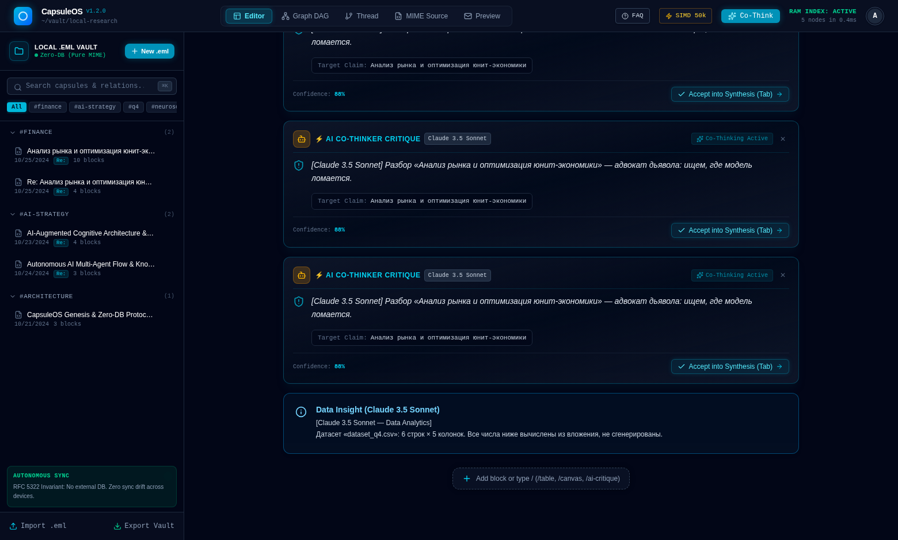
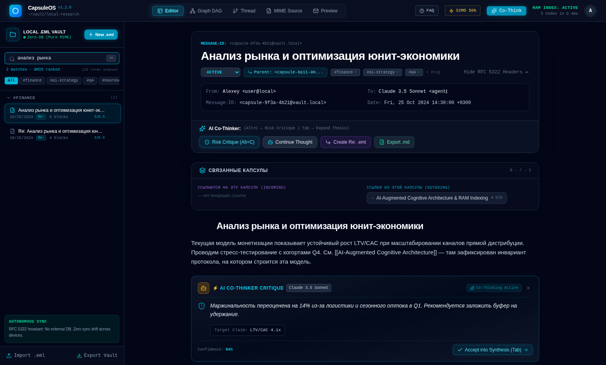
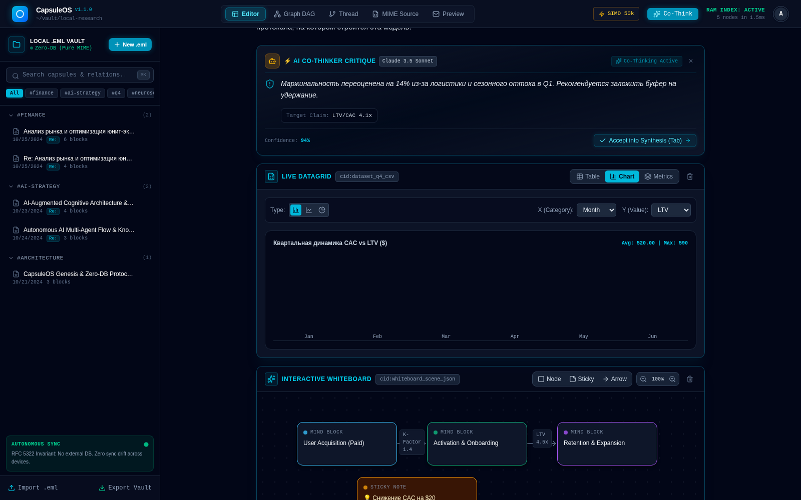
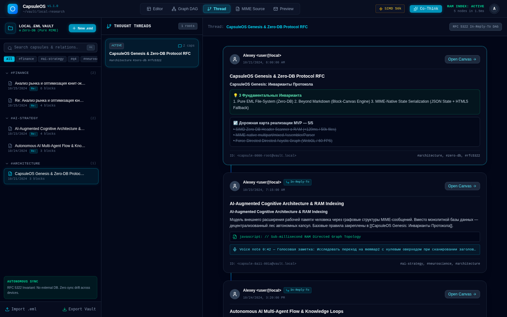
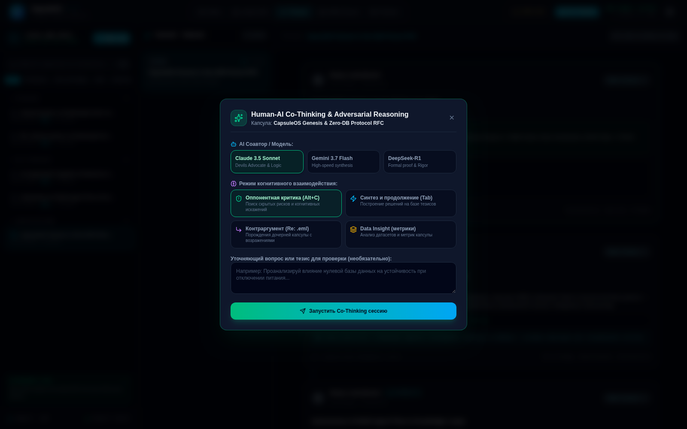
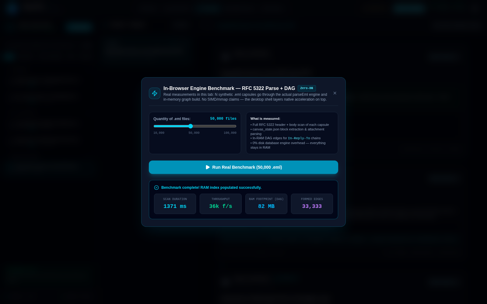
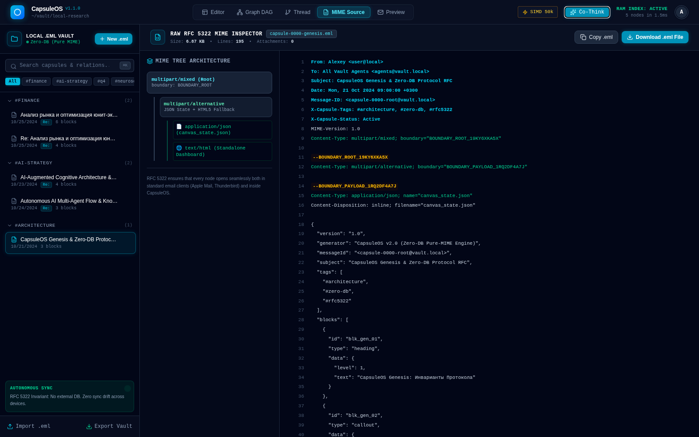
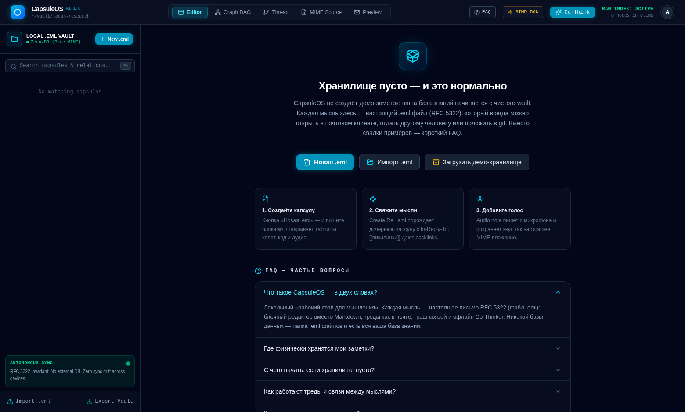

<div align="center">

# 🧠 CapsuleOS

### Ваша база знаний — это папка с письмами.

**Мультимодальное рабочее пространство и персональный движок знаний без базы данных.**
Каждая заметка, таблица, вайтборд и голосовая memorandum — обычное **RFC 5322 `.eml`-сообщение**:
без SQL, без документных СУБД, без облака и vendor lock-in. Файлы, которые открываются в любом почтовом клиенте, ищутся `grep`-ом, диффятся и хранятся десятилетиями.

[](https://github.com/kostyk348/capsuleos/releases)
[](https://github.com/kostyk348/capsuleos/actions/workflows/ci.yml)
[](https://github.com/kostyk348/capsuleos/actions/workflows/ci.yml)
[](LICENSE)
[](https://v2.tauri.app/)
[](https://react.dev/)
[](#-почему)
[](#-данные-и-приватность)
[](CONTRIBUTING.md)

[English](README.md) · **Русский**


</div>

---

## 🧭 Коротко

- 📦 **Zero-DB.** Одна капсула = один `.eml`-файл на диске. Thunderbird прочтёт ваши заметки, `grep` найдёт, `rsync` синхронизирует.
- 🧱 **Больше, чем Markdown.** Блочный редактор: заголовки, callout'ы, TODO, живые DataGrid'ы из CSV с графиками, вайтборды, код-REPL, голосовые заметки — всё в одном MIME-контейнере.
- 🤖 **Офлайн-соавтор.** Детерминированный локальный ИИ-оппонент критикует тезисы, продолжает мысли и анализирует датасеты. Без API-ключа, без сети.
- ⚡ **Быстро.** Честный бенчмарк в браузере парсит **50 000 капсул примерно за 1.4 с** (~36k файлов/с) — измерено, а не заявлено.

> Известные пробелы перечислены в [LIMITATIONS.md](LIMITATIONS.md) — пункты роадмапа не выдаются за готовые функции.

## 🆕 Что нового в v1.4.0

> Релиз «рабочее пространство, которое не врёт». [Полный changelog →](CHANGELOG.md)

| | |
|---|---|
| 📋 **Планирование** | Задачи по всему хранилищу: сетка месяца, просроченные / сегодня / неделя, приоритеты, экспорт ICS (VTODO). Сроки и приоритеты хранятся внутри TODO-блоков `.eml` |
| 🗂 **Kanban + `/task`** | Доска «К выполнению / В работе / Готово» с drag-and-drop и статусом на карточке; `/task` превращает абзац, в котором вы печатаете, в отслеживаемую задачу |
| 📈 **Gantt-таймлайн** | Шкала по дням с полосами «начало → срок», отметкой «сегодня», стрелками зависимостей и предупреждением о заблокированных задачах. Циклы отсекаются до добавления связи — без фейкового прогресса |
| ⌨️ **Палитра команд и история** | `Ctrl/Cmd+K` ищет любое действие; undo/redo возвращает правки капсул |
| 🌍 **RU / EN** | Локализация интерфейса с переключателем — русский по умолчанию, английский перевод (часть подписей внутри блоков пока не переведена) |
| 🎙️ **Только реальное аудио** | Новая голосовая заметка сразу начинает запись с микрофона; если микрофона нет — предлагает выбрать файл. Фейковые волны, таймеры и бейдж `SIMULATED` удалены |
| 🧹 **Без демо-контента** | Чистая установка стартует действительно пустой — демо-хранилище, его загрузчик и все демо-строки удалены |

## 🆕 Что нового в v1.3.0

> Релиз «ИИ наконец читает ваши заметки». [Полный changelog →](CHANGELOG.md)

| | |
|---|---|
| 🤖 **Честный офлайн-ИИ** | Co-Thinker больше не декламирует зашитый текст про LTV/CAC: он цитирует ваши реальные числовые утверждения, извлекает фактические ключевые темы, прогоняет правило-ориентированный скан рисков и считает настоящую статистику по приложенным CSV — а при отсутствии данных открыто отказывается выдумывать числа. Детерминированно, офлайн, с персонами |
| ≈ **Похожие по смыслу** | Новая секция «Похожие по смыслу»: tf-idf косинусная близость поверх поискового индекса ранжирует все капсулы относительно текущей, с процентными бейджами. Без LLM и эмбеддингов — просто математика по индексу |
| 🧪 **57 тестов движка** | CSV-математика, майнинг утверждений, правила рисков, анти-шаблонная регрессия, similarity |



## 🆕 Что нового в v1.2.0

> Релиз «поиск, который понимает, что важно». [Полный changelog →](CHANGELOG.md)

| | |
|---|---|
| 🔍 **Поиск на BM25** | Полнотекстовый поиск теперь ранжируется по Okapi BM25 поверх инвертированного индекса: редкие термины весят больше, частота термина насыщается, длинные капсулы не выигрывают только за счёт длины. Префиксный матчинг находит «юнит» внутри «юнит-экономики», ничьи отходят более новым капсулам — а сайдбар показывает балл релевантности каждого совпадения |
| 🐧 **Linux-сборки** | Релизы теперь поставляют `AppImage` (портативный) и `.deb` (Debian/Ubuntu) рядом с Windows MSI/NSIS — двухплатформенная матрица сборки с SHA256-суммами для каждого артефакта |
| 🧪 **30 тестов движка** | 13 новых тестов покрывают ранжирование: IDF, насыщение tf, нормализацию длины, префиксные термы, целостность корпуса |



## 🆕 Что нового в v1.1.0

> Релиз «сделать честно и заставить работать». [Полный changelog →](CHANGELOG.md)

| | |
|---|---|
| 🔧 **13 багов исправлено** | Фантомные вложения, мёртвые режимы Co-Think, ложные срабатывания slash-меню, двойная решётка в тегах, мёртвый ⌘K, зависающий REPL, граф без зума, невидимые блоки в тредах… |
| 🎙 **Настоящие аудиозаметки** | Голосовые мемо теперь реальные MIME-аудиовложения с waveform и перемоткой — запись прямо с микрофона, бейдж `SIMULATED` наконец означает «не симуляция» |
| 🗺 **Старт с пустого хранилища** | При первом запуске больше нет демо-заметок: чистый vault и встроенный FAQ вместо них |
| 📊 **Честный бенчмарк** | Модалка «SIMD 50k» реально прогоняет 50k синтетических `.eml` через движок парсинга. Больше никаких фейковых цифр на setInterval |
| 🧪 **17 тестов** | MIME round-trip, регрессия фантомных вложений, HTML-escaping, викилинки, правила каретки — подключены к CI |
| 📤 **Экспорт в HTML** | Вид Preview экспортирует автономный `.html`-дашборд |

## ❓ Почему

Большинство заметочных приложений хранят знания в проприетарной базе. Ваши заметки принадлежат вам лишь до тех пор, пока живо приложение и не поменялась схема.

CapsuleOS переворачивает это:

| Обычный PKM | CapsuleOS |
|---|---|
| SQLite / проприетарное хранилище | Обычные `.eml`-файлы на диске |
| Экспорт = потери при конвертации в Markdown | Экспорт = файл, который у вас уже есть |
| Треды и связи — внутренняя логика приложения | `In-Reply-To` / `References` — семантика RFC 5322 |
| Вложения — вендорные бинарные блобы | Стандартные MIME-части, адресуемые через `Content-ID` |
| Облачная синхронизация, аккаунт, телеметрия | Локальный vault, офлайн по умолчанию |

Вся база знаний — это **папка с сообщениями**: ищется grep-ом, диффится, резервируется любым инструментом, читается десятилетиями.

## ✨ Экскурсия по фичам

### 🧱 Блочный редактор

<table>
<tr>
<td></td>
</tr>
<tr>
<td align="center"><sub>Живой DataGrid (графики из CSV) · интерактивный вайтборд с майнд-блоками и стикерами</sub></td>
</tr>
</table>

- Заголовки, абзацы, callout'ы, TODO — с живым инлайн-Markdown.
- **Живой DataGrid** — таблицы из CSV/JSON-вложений с видами «график» и «сводная».
- **Вайтборд** — фигуры, стикеры, узлы майнд-карт и стрелки на холсте.
- **Код-REPL** — JavaScript исполняется в изолированном Web Worker со сторожем на 3 с (бесконечный цикл не уронит приложение); JSON валидируется и форматируется.
- **Аудиозаметки** — запись прямо с микрофона или прикрепление файла; настоящее аудио с waveform-перемоткой и бейджем длительности, хранится как MIME-часть того же `.eml`.
- **ИИ-оппонент** — блок критики, который спорит с тезисом, к которому прикреплён.

### 🕸 Граф и треды

<table>
<tr>
<td width="50%"></td>
<td width="50%"></td>
</tr>
<tr>
<td align="center"><sub>DAG связей · зум · физика · палитра тегов</sub></td>
<td align="center"><sub>Треды мыслей · цепочки RFC 5322 In-Reply-To</sub></td>
</tr>
</table>

- Мгновенный граф связей (`in_reply_to`, `references`, викилинки) со спутниковыми превью.
- Треды: линейные и ветвящиеся цепочки рассуждений, собранные из реальных блоков капсул.
- `[[викилинки]]` с автодополнением, кликабельные обратные ссылки и панель **Связанных капсул**.

### 🤖 Офлайн Co-Thinker

<table>
<tr>
<td></td>
</tr>
<tr>
<td align="center"><sub>Четыре режима: критика · синтез · контраргумент · анализ данных</sub></td>
</tr>
</table>

- Детерминированный локальный ассистент: `critique`, `continue`, `reply_thread`, `data_insight`.
- Без API-ключа и сетевых вызовов — приложение полностью офлайн.
- Режим контраргумента порождает **дочернюю `.eml`-капсулу** с AI-блоками — ваш спор становится частью RFC 5322 DAG.

### ⚡ Честный бенчмарк и MIME-инспектор

<table>
<tr>
<td width="50%"></td>
<td width="50%"></td>
</tr>
<tr>
<td align="center"><sub>Честный бенчмарк — 50k капсул, 1371 мс, 36k файлов/с</sub></td>
<td align="center"><sub>Инспектор RFC 5322 — каждый заголовок, каждая часть</sub></td>
</tr>
</table>

- Модалка бенчмарка реально прогоняет N синтетических капсул через `parseEml` + построение графа и показывает фактические цифры.
- MIME-инспектор показывает полное дерево и сырой исходник любой капсулы — можно скопировать или скачать точный `.eml`.

## 📦 Формат капсулы

Капсула — обычное письмо. Откройте его в Thunderbird, mutt или своём бэкап-инструменте:

```eml
Message-ID: <capsule-1755000000000@vault.local>
Subject: Q4 pricing experiment
From: Owner <owner@vault.local>
To: Vault <vault@capsuleos.local>
Date: Tue, 12 Aug 2026 09:14:00 +0000
In-Reply-To: <capsule-root@vault.local>
References: <capsule-root@vault.local>
X-Capsule-Tags: pricing, experiment
X-Capsule-Status: Active
MIME-Version: 1.0
Content-Type: multipart/mixed; boundary="capsule-boundary"

--capsule-boundary
Content-Type: text/html; charset=utf-8

<h1>Q4 pricing experiment</h1>
<p>Fallback HTML view for any mail client.</p>

--capsule-boundary
Content-Type: application/json; name="blocks.json"
Content-Disposition: attachment; filename="blocks.json"
Content-ID: <blocks_json>

[{"id":"blk_1","type":"heading","data":{"level":1,"text":"Q4 pricing experiment"}}]

--capsule-boundary
Content-Type: text/csv; name="cohorts.csv"
Content-Disposition: attachment; filename="cohorts.csv"
Content-ID: <dataset_cohorts_csv>

cohort,users,conversion
Q4-A,1200,0.041

--capsule-boundary--
```

JSON-часть — структурированный блочный холст; HTML-часть — человекочитаемый фолбэк; остальные части — датасеты и вложения, адресуемые через `Content-ID` из блоков DataGrid.

## 🚀 Начало работы

### Скачать (Windows и Linux)

Готовые инсталляторы приложены к каждому [релизу](https://github.com/kostyk348/capsuleos/releases/latest):

| Файл | Что это |
|---|---|
| `CapsuleOS_*_x64_en-US.msi` | Пакет Windows Installer |
| `CapsuleOS_*_x64-setup.exe` | Инсталлятор NSIS |
| `CapsuleOS_*_amd64.AppImage` | Linux — портативный, `chmod +x` и запуск |
| `CapsuleOS_*_amd64.deb` | Linux — пакет Debian / Ubuntu |

- Windows требует **WebView2 Runtime** от Microsoft Edge (предустановлен в Windows 10/11; иначе [скачайте](https://developer.microsoft.com/microsoft-edge/webview2/)).
- Linux-сборки ориентированы на **glibc 2.35+** (собраны на Ubuntu 22.04); WebKitGTK 4.1 — рантайм-зависимость (`sudo apt install libwebkit2gtk-4.1-0`), AppImage вшивает большинство библиотек.
- Инсталляторы пока **не подписаны** — SmartScreen может предупредить: *More info → Run anyway*.
- `SHA256SUMS.txt` публикуется для каждого артефакта.

Сборки для macOS пока не поставляются — соберите из исходников ниже.

### Первый запуск

CapsuleOS стартует с **пустого хранилища** — никаких демо-заметок. Вместо них — встроенный онбординг-экран: он объясняет концепцию `.eml`, отвечает на частые вопросы и предлагает два действия — создать капсулу или импортировать `.eml`. FAQ доступен в любой момент по кнопке **FAQ** в верхней панели.



### Сборка из исходников

**Требования**

- [Rust](https://rustup.rs/) 1.77.2+ (stable)
- [Node.js](https://nodejs.org/) 20+ с npm
- Только для Linux: `webkit2gtk-4.1`, `gtk3`, `librsvg2`, `libayatana-appindicator3`, `patchelf`
- Windows: MSVC build tools + WebView2 · macOS: Xcode command line tools

```bash
git clone https://github.com/kostyk348/capsuleos.git
cd capsuleos
npm ci
npm run tauri:dev      # окно разработки с hot reload
npm run tauri:build    # релизные инсталляторы
```

Результат:

- бинарник — `src-tauri/target/release/capsuleos` (`capsuleos.exe` на Windows)
- пакеты — `src-tauri/target/release/bundle/` (`.msi`/`.exe` на Windows, `.deb`/`.rpm`/`.AppImage` на Linux, `.app` на macOS)

### Веб-режим (без десктоп-оболочки)

```bash
npm ci
npm run dev            # Vite dev-сервер на http://localhost:5173
npm run build          # прод-сборка в dist/
npm run preview        # раздача сборки
npm test               # движок-тесты vitest (109 шт.)
```

В обычном браузере vault падает на `localStorage`; нативный доступ к файлам — только через Tauri.

## 🏗 Архитектура

```text
┌──────────────────────────────────────────────────────────────────────┐
│                        Десктоп-оболочка Tauri 2                      │
│  src-tauri/src/lib.rs — файловый IO, диалоги, app-data dir (Rust)    │
├──────────────────────────────────────────────────────────────────────┤
│  React 19 UI                                                         │
│  components/         канвас-редактор · DataGrid · граф · треды       │
│  components/blocks/  по компоненту на тип блока                      │
├──────────────────────────────────────────────────────────────────────┤
│  Движок (чистый TypeScript, покрыт тестами)                          │
│  engine/mime.ts          сборка / разбор RFC 5322, CIDs              │
│  engine/vaultStore.ts    граф-хранилище, инвертированный индекс      │
│  engine/desktopStore.ts  Tauri IPC-мост к реальной файловой системе  │
│  engine/offlineAi.ts     детерминированный офлайн Co-Thinker         │
│  engine/markdown.tsx     рендер инлайн-Markdown                      │
├──────────────────────────────────────────────────────────────────────┤
│  Хранилище = ваша папка                                              │
│  vault/*.eml   одно текстовое сообщение на капсулу                   │
│  vault.json    одноразовый снапшот индекса (папка главнее)           │
└──────────────────────────────────────────────────────────────────────┘
```

```text
src/
  engine/                 ядро zero-DB (MIME, хранилище, офлайн-ИИ)
  components/             канвас-редактор, DataGrid, граф, треды, инспектор
  components/blocks/      по компоненту на тип блока
  types.ts                типы капсул / блоков / графа
src-tauri/                Rust-оболочка: файловый IO, диалоги, конфиг пакета
.github/workflows/        ci.yml · release.yml (Windows x64 msi + nsis)
```

## 🔒 Данные и приватность

Всё локально. Ничего не покидает машину: приложение само не делает сетевых вызовов.

| ОС | Расположение vault |
|---|---|
| Windows | `%APPDATA%\com.capsuleos.app\` |
| Linux | `~/.local/share/com.capsuleos.app/` |
| macOS | `~/Library/Application Support/com.capsuleos.app/` |

Внутри: `vault/` с одним `.eml` на капсулу и `vault.json` как кэш-снапшот индекса. Удалите папку — удалите рабочее пространство. Скопируйте — унесите всю базу знаний с собой.

## 🗺 Роадмап

- ✅ v1.0 — блочный канвас, `.eml`-vault, граф, треды, оболочка Tauri
- ✅ v1.1 — точность движка + тесты, настоящий звук, честный бенчмарк, HTML-экспорт, онбординг с пустым хранилищем и FAQ
- ✅ v1.2 — ранжирование поиска по Okapi BM25 с баллами релевантности, Linux-сборки (AppImage / deb) в релизном пайплайне
- ⬜ Слежение за папкой — живая синхронизация vault без перезапуска
- ⬜ GPG-подпись капсул (подлинность мыслей)
- ⬜ Python-ячейки через Pyodide, Rust-ячейки через WASM
- ⬜ Сборки macOS в релизном пайплайне
- ⬜ Опциональная E2E-шифрованная синхронизация vault (папка `.eml` уже переносима)

## 📊 Статус

`v1.3.0` — десктоп-приложение работоспособно от начала до конца. Движок покрыт suite'ом vitest (MIME round-trip, ранжирование BM25, контент-зависимый офлайн-ИИ, CSV-аналитика, регрессия фантомных вложений, хелперы редактора). Известные шероховатости:

- инсталляторы не подписаны кодовой подписью (SmartScreen предупреждает);
- Python/Rust-ячейки хранятся и версионируются, но не исполняются офлайн (WASM-интерпретаторы не вшиты);
- браузерный бенчмарк парсит 50k синтетических капсул за ~1.3 с — реальный холодный скан папки медленнее.

## ⁇ FAQ

**Что такое CapsuleOS — в двух словах?**
Локальный «рабочий стол для мышления». Каждая мысль — настоящее письмо RFC 5322 (файл `.eml`): блочный редактор вместо Markdown, треды как в почте, граф связей и офлайн Co-Thinker. Никакой базы данных — папка `.eml`-файлов и есть вся база знаний.

**Где физически хранятся мои заметки?**
В десктоп-версии — папка `vault/` внутри каталога данных приложения: по одному `.eml` на капсулу, `vault.json` — только кэш. В браузере — `localStorage`. Положили чужой `.eml` в папку — он появился в хранилище; удалили файл — капсула исчезла.

**Как работают треды и связи?**
Ответ на мысль — это дочерний `.eml` с заголовками `In-Reply-To` / `References` — ровно как в email. [[викилинки]] дают обратные ссылки (backlinks), а Graph DAG и Thought Threads показывают всё дерево размышления.

**Как записать голосовую заметку?**
Наберите `/` в редакторе, выберите *Audio note* и нажмите запись: звук пишется с микрофона прямо в приложение (MediaRecorder) и сохраняется как MIME-вложение webm/opus с реальной длительностью и волной. Полностью офлайн.

**Куда отправляются мои данные?**
Никуда. Разбор MIME, поиск, бенчмарк и Co-Thinker работают локально — ни сети, ни телеметрии, ни API-ключей. Выдерните шнур — всё продолжит работать.

**Как сделать резервную копию?**
«Export Vault» в сайдбаре собирает ZIP со всеми `.eml` — или просто скопируйте папку `vault/`, это и есть вся база.

**Почему `.eml`, а не база данных?**
`.eml` — открытый стандарт, который старше многих NoSQL-мод: любой почтовый клиент его прочтёт, git его продиффит, миграции не нужны никогда. База данных умирает вместе с приложением, письма — нет.

## 🤝 Участие в разработке

Issues и PR приветствуются — см. [CONTRIBUTING.md](CONTRIBUTING.md). Изменения отслеживаются в [CHANGELOG.md](CHANGELOG.md).

<div align="center">

**CapsuleOS** — ваши мысли, хранящиеся как почта.

[Скачать](https://github.com/kostyk348/capsuleos/releases/latest) · [Changelog](CHANGELOG.md) · [Сообщить о баге](https://github.com/kostyk348/capsuleos/issues) · [Лицензия MIT](LICENSE)

</div>
