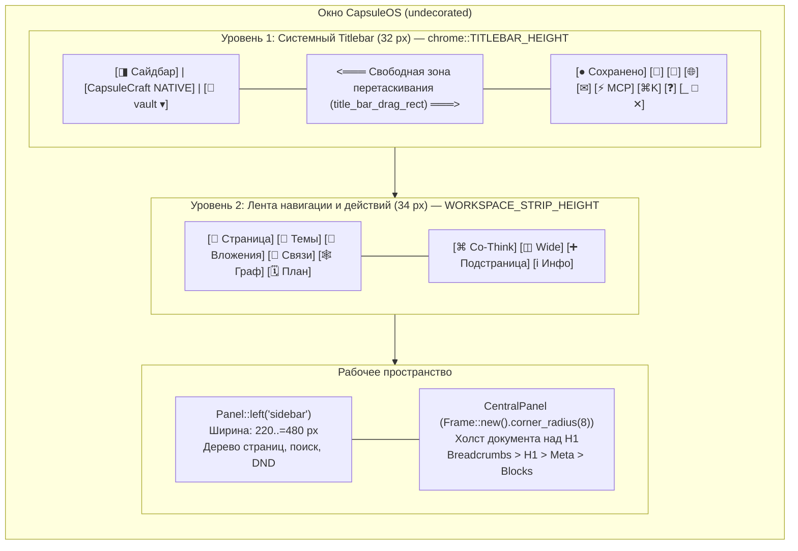

# Редизайн интерфейса нативного клиента (GUI Redesign & Two-Tier Architecture) — Руководство для мейнтейнера

Данный документ содержит полное техническое описание архитектуры, компонентов и решений, реализованных в ветке `gui-redesign` нативного клиента CapsuleCraft / CapsuleOS (`native/src/main.rs`, `native/src/chrome.rs`, `native/src/ui_state.rs`, `native/src/i18n.rs`, `native/src/icons.rs`, `native/src/views/palette.rs`).

---

## 1. Концепция и предпосылки редизайна

До проведения редизайна нативный клиент CapsuleCraft на базе `egui`/`eframe` обладал рядом эргономических и композиционных недостатков:

1. **Горизонтальная перегрузка Titlebar:** в единой полосе высотой 40 px размещались одновременно бренд, бейдж, хранилище, кнопка сворачивания сайдбара, 6 вкладок навигации разделов, системные утилиты и кнопки управления окном Windows (`_ □ ✕`). При ширине окна < 1150 px вкладки обрезались или наезжали на правые кнопки.
2. **Коллизия в панели документа (`draw_content_header`):** полоса заголовка документа высотой 48 px содержала хлебные крошки слева и блок действий (`Co-Think (офлайн)`, `+ Подстраница`, `Wide`, `Инфо`) справа. При сужении окна кнопки физически перекрывали название заметки.
3. **Нерациональный расход высоты экрана:** суммарная высота хрома шапки составляла **88 px** (40 px Titlebar + 48 px Content Header), что существенно уменьшало рабочую область документа на экранах ноутбуков.
4. **Конфликт перетаскивания окна:** клики по элементам Titlebar могли ошибочно интерпретироваться как начало перетаскивания окна (`StartDrag`).
5. **Залипание кнопки сайдбара:** при передаче `!sidebar_collapsed` в параметр `enabled` вместо `active` кнопка сворачивания сайдбара блокировалась после закрытия панели, лишая пользователя возможности открыть сайдбар кликом мыши.
6. **Ограниченная ширина холста:** холст документа был зажат в узком диапазоне `480..=760 px`, что создавало избыточные пустые поля на экранах высокого разрешения.

### Цели редизайна:
- Внедрить **двухуровневую архитектуру шапки (Two-Tier Architecture)**:
  - **Уровень 1 (32 px):** Системный Titlebar (бренд, хранилище, сайдбар, просторный Drag Handle, утилиты, кнопки окна).
  - **Уровень 2 (34 px):** Рабочая лента разделов (Workspace Strip) с 6 вкладками навигации и контекстными действиями.
- Устранить отдельную панель документа `draw_content_header`, перенеся хлебные крошки непосредственно в холст документа над заголовком H1.
- Уменьшить общую высоту шапки с 88 px до **66 px** (+22 px чистого вертикального пространства).
- Внедрить персистентный модуль состояния интерфейса `UiState` (ширина сайдбара, состояние сворачивания, режим широкого холста).
- Обеспечить адаптивность холста (`clamp(480.0, 960.0)`) и полноэкранный режим `Wide Canvas` по `Ctrl + Shift + W`.

---

## 2. Архитектура интерфейса



---

## 3. Компоненты и техническая реализация

### 3.1. Персистентное состояние интерфейса (`native/src/ui_state.rs`)
Для сохранения пользовательских настроек UI между запусками приложения создан автономный модуль `UiState`:
- **Файл на диске:** `.capsuleos-ui.json` в корне активного хранилища (с фоллбэком на директорию конфигурации ОС).
- **Структура полей:**
  ```rust
  pub struct UiState {
      pub sidebar_width: f32,       // По умолчанию: 260.0 px (диапазон 220.0..=480.0 px)
      pub sidebar_collapsed: bool,   // Флаг скрытия боковой панели
      pub wide_canvas: bool,         // Режим широкого холста (Wide Canvas)
      pub zoom: f32,                 // Масштаб интерфейса
  }
  ```
- **Методы:** `load()`, `save()`, `toggle_sidebar()`, `toggle_wide()`.
- Изменения ширины сайдбара интерактивным ползунком `Panel::left.resizable(true)` синхронизируются в `self.ui_state.sidebar_width` при отклонении > 0.5 px.

---

### 3.2. Системный оконный хром (`native/src/chrome.rs`)
- **Константы высоты:**
  ```rust
  pub const TITLEBAR_HEIGHT: f32 = 32.0;
  pub const WORKSPACE_STRIP_HEIGHT: f32 = 34.0;
  ```
- **Изолированная зона перетаскивания окна (`title_bar_drag_rect`):**
  Ранее перетаскивание вешалось на всю область Titlebar, вызывая ложные срабатывания при клике по мелким кнопкам. Теперь функция принимает точный прямоугольник свободного пространства `drag_rect` между левой и правой группами контролов:
  ```rust
  pub fn title_bar_drag_rect(ui: &mut Ui, rect: Rect) {
      if rect.width() <= 10.0 || rect.height() <= 10.0 {
          return;
      }
      let edge_rect = Rect::from_min_max(rect.min + vec2(0.0, RESIZE_EDGE), rect.max);
      let resp = ui.interact(edge_rect, ui.scope_id().with("title-bar-drag-rect"), Sense::click_and_drag());
      if resp.drag_started_by(egui::PointerButton::Primary) {
          ui.ctx().send_viewport_cmd(egui::ViewportCommand::StartDrag);
      }
      if resp.double_clicked() {
          let maximized = ui.input(|i| i.viewport().maximized.unwrap_or(false));
          ui.ctx().send_viewport_cmd(egui::ViewportCommand::Maximized(!maximized));
      }
  }
  ```
- Кнопки управления окном (`_ □ ✕`) автоматически масштабируются под высоту 32 px (`BUTTON_WIDTH = 46.0`, `height = 32.0`).

---

### 3.3. Разделение шапки на два яруса (`native/src/main.rs`)

#### Ярус 1: `draw_titlebar` (высота 32 px)
Выполняет функции заголовка приложения и системного окна:
- **Левая группа (`left_to_right`):**
  1. `Icon::Sidebar` — переключатель боковой панели с тултипом `(Ctrl + \)`. Передаются аргументы `(enabled = true, active = !sidebar_collapsed)`.
  2. Вертикальный разделитель `theme::hairline()`.
  3. Логотип CapsuleCraft (текстура или векторный фоллбэк).
  4. Заголовок `CapsuleCraft` + моноширинный бейдж `NATIVE`.
  5. Вертикальный разделитель.
  6. `vault_switcher` — название папки текущего хранилища с выпадающей стрелкой.
- **Центральная зона:** `chrome::title_bar_drag_rect(ui, drag_rect)` — плавная зона перемещения окна и двойного клика для максимизации.
- **Правая группа (`right_to_left`):**
  1. Кнопки закрытия, разворачивания, сворачивания (`caption_buttons`).
  2. Кнопка выхода из Zen-режима (при `zen_mode == true`).
  3. `[❓]` Справка / FAQ (`F1`).
  4. `[⌘K]` Палитра команд (`Ctrl+K`).
  5. `[⚡]` Подключение MCP-сервера.
  6. `[✉]` Статус IMAP с цветовым индикатором синхронизации.
  7. `[🌐]` Переключатель языка (En / Ru).
  8. `[🔄]` Перезагрузка хранилища с диска.
  9. `[💾]` Принудительное сохранение (активна при `dirty == true`).
  10. Индикатор статуса сохранения (зеленая/желтая/красная точка с поясняющим текстом).
- **Нижняя граница:** тонкая разделительная линия `hline(total_rect.x_range(), total_rect.bottom() - 0.5, theme::hairline())`.

#### Ярус 2: `draw_workspace_strip` (высота 34 px)
Служит главной лентой переключения контекста и рабочих представлений:
- **Левая группа:** вызов `views::nav(left_ui, view, locale)`. Отрисовывает 6 вкладок:
  - `[📄 Страница]` (`View::Page`)
  - `[🧵 Темы]` (`View::Mail`)
  - `[📎 Вложения]` (`View::Mime`)
  - `[🔗 Связи]` (`View::Graph`)
  - `[🕸 Граф]` (`View::Threads`)
  - `[🗓 План]` (`View::Planning`)
  - *Адаптивность:* при сужении области < 430 px неактивные вкладки автоматически переходят в компактный режим (только векторная иконка без текста).
- **Правая группа (контекстные действия для активного вида):**
  - При `view == View::Page`:
    - `[ℹ Инфо]` — поповер свойств страницы (Message-ID, файл, даты, формат).
    - `[➕ Подстраница]` — создание дочерней заметки в дереве.
    - `[◫ Wide / Standard]` — переключение ширины холста (`Ctrl+Shift+W`).
    - `[⌘ Co-Think]` — модальное окно локального ИИ-ассистента.
- **Скрытие в Zen-режиме:** панель полностью скрывается при включенном режиме дзен, возвращая 100% экрана тексту.

---

### 3.4. Ликвидация `draw_content_header` и перенос хлебных крошек
- Функция `draw_content_header` (48 px) полностью удалена из кодовой базы.
- Реализована функция `draw_breadcrumbs(ui, ancestors, locale, &mut action)`.
- В `draw_document` хлебные крошки отрисовываются первой строкой холста документа перед полем ввода заголовка H1:
  ```rust
  ui.set_width(content_w);
  ui.add_space(24.0);

  draw_breadcrumbs(ui, ancestors, locale, &mut action);
  ui.add_space(12.0);

  if capsule.native {
      // Редактируемый H1 заголовок
  }
  ```
- **Преимущества переноса:**
  - Крошки отображаются в естественной позиции (как в Obsidian, Notion, Craft).
  - Крошки занимают всю доступную ширину холста (до 960 px), не конфликтуя ни с какими кнопками.
  - Клик по любому предку в цепочке мгновенно выбирает родительскую страницу (`action.select = Some(ancestor_idx)`).

---

### 3.5. Адаптивная ширина холста документа
В `draw_document` внедрена поддержка двух режимов ширины:
```rust
let available = ui.available_width();
let (content_w, pad) = if wide_canvas {
    let w = (available - 96.0).max(480.0);
    let p = ((available - w) / 2.0).max(48.0);
    (w, p)
} else {
    let w = (available - 96.0).clamp(480.0, 960.0);
    let p = ((available - w) / 2.0).max(28.0);
    (w, p)
};
```
1. **Стандартный режим (Standard):** центрированный холст комфортной для чтения ширины от 480 до 960 px.
2. **Широкий режим (Wide):** холст динамически растягивается на всю доступную ширину окна за вычетом симметричных отступов по 48 px с каждой стороны.
3. **Управление:** кнопка `Wide/Standard` в Workspace Strip, горячая клавиша `Ctrl + Shift + W`, или команда в палитре `Ctrl + K`.

---

### 3.6. Устранение наложения сайдбара на CentralPanel
В `draw_sidebar` устранена проблема сжатия и наложения правого края панели:
```rust
let outer = ui.max_rect();
ui.allocate_rect(outer, Sense::hover());
ui.set_min_width(outer.width());
```
Это гарантирует, что `egui` резервирует точные геометрические границы для боковой панели, а центральная карточка `CentralPanel` не налезает на элементы дерева страниц при горизонтальном ресайзе окна.

---

### 3.7. Режим погружения и фокусировки (Zen Focus Mode)
Для обеспечения иммерсивного опыта письма без отвлекающих визуальных элементов реализован Zen-режим:
- **Активация:** клавиша `F11`, комбинация `Ctrl + Shift + F` или через командную палитру `Ctrl + K` (`"zen_mode"`).
- **Поведение интерфейса в Zen-режиме:**
  - Сайдбар и второй ярус (Workspace Strip) полностью скрываются.
  - Оконный Titlebar скрывается по умолчанию и плавно проявляется только при подведении курсора мыши к верхнему краю экрана (`pointer.y < chrome::TITLEBAR_HEIGHT`).
  - В Titlebar при наведении отображается выделенная кнопка быстрого выхода `[Zen ✕]` слева от кнопок управления окном.
- **Выход из режима:** клавиша `Escape` (при отсутствии открытых модальных окон), повторное нажатие `F11` или клик по кнопке `[Zen ✕]`.
- **Нотификации:** появление тоста с подсказкой `Режим фокуса (F11 / Esc для выхода)`.

---

### 3.8. Интерактивное масштабирование интерфейса (Zoom Controls)
- `Ctrl + Plus` / `Ctrl + =` — пошаговое увеличение масштаба (+10%).
- `Ctrl + Minus` — пошаговое уменьшение масштаба (-10%).
- `Ctrl + 0` — сброс масштаба к дефолтному значению (110%).
- Выбранный коэффициент масштабирования сохраняется в `UiState` (`.capsuleos-ui.json`) и восстанавливается при следующем запуске приложения. Тост отображает текущий уровень зума в процентах.

---

## 4. Соблюдение правил Vector-First UI (Zero-Emoji)

Интерфейс строго следует правилу отказа от глифов Emoji и неподдерживаемых символов Unicode:
- Статусы, точки синхронизации и бейджи рисуются векторными кружками: `ui.painter().circle_filled(center, radius, color)`.
- Иконки кнопок отрисовываются через векторный модуль `icons::paint(painter, rect, icon, color)`.
- Разделители отрисовываются линиями `painter().hline(...)` и `painter().vline(...)`.
- Отсутствуют символы «тофу» (`□`) на любых сборках Windows и Linux.

---

## 5. Сводная таблица горячих клавиш

| Сочетание клавиш | Действие | Контекст |
|---|---|---|
| `Ctrl + \` | Свернуть / развернуть боковую панель | Глобально |
| `Ctrl + Shift + W` | Переключить режим холста (Wide / Standard) | Редактор страницы |
| `Ctrl + K` | Открыть палитру команд | Глобально |
| `F1` | Открыть справку и горячие клавиши | Глобально |
| `Ctrl + S` | Сохранить текущую страницу на диск | Глобально |
| `Ctrl + N` | Создать новую корневую страницу | Глобально |
| `Ctrl + Shift + N` | Создать дочернюю подстраницу | Редактор страницы |
| `F11` | Включить / выключить Zen-режим | Глобально |

---

## 6. Регламент сборки и проверки (DoD)

При внесении любых дальнейших правок в область UI нативного клиента мейнтейнер обязан соблюдать Resource Guard:

### 1. Запуск тестового пакета (Строго `-j 1`):
```powershell
cargo test --manifest-path native/Cargo.toml -j 1
```
*Критерий успеха:* 102 теста успешно пройдены (`102 passed, 0 failed`).

### 2. Сборка оптимизированного релиза (Строго `-j 1`):
```powershell
cargo build --manifest-path native/Cargo.toml --release -j 1
```
*Результат:* исполняемый файл `native/target/release/capsuleos-native.exe` (~12.3 МБ).

### 3. Автоматизированный релизный конвейер CI/CD (`release.yml`):
В релизном пайплайне внедрена трехэтапная архитектура:
1. **`create-release`:** предварительно создает черновик релиза на GitHub, гарантируя отсутствие гонок (`race condition`).
2. **Параллельная матрица:**
   - `native-windows`: компиляция и упаковка `CapsuleCraft_native_${VER}_x64.zip` (автономный `.exe` без WebView2);
   - `native-appimage`: сборка с glibc 2.35 и linuxdeploy (`CapsuleCraft_${VER}_amd64.AppImage`);
   - `native-macos`: сборка arm64 и упаковка `CapsuleCraft_native_${VER}_arm64.app.zip`;
   - `build`: сборка Tauri web-пакетов (`.msi`, `-setup.exe`, `.deb`, `.rpm`, `.dmg`).
3. **`finalize-release`:** скачивает все готовые дистрибутивы, рассчитывает общий `SHA256SUMS.txt` и публикует релиз.

---

## 7. Файловая карта изменений

| Файл | Внесенные изменения |
|---|---|
| [`native/src/ui_state.rs`](file:///d:/Projects/active/capsuleos/native/src/ui_state.rs) | Новый модуль персистентного хранения UI-настроек (`UiState`). |
| [`native/src/chrome.rs`](file:///d:/Projects/active/capsuleos/native/src/chrome.rs) | Высота `TITLEBAR_HEIGHT` (32 px), `WORKSPACE_STRIP_HEIGHT` (34 px), функция `title_bar_drag_rect`. |
| [`native/src/main.rs`](file:///d:/Projects/active/capsuleos/native/src/main.rs) | Двухъярусная шапка (`draw_titlebar` + `draw_workspace_strip`), `draw_breadcrumbs`, интеграция `ui_state`, `wide_canvas`, фикс сайдбара. |
| [`native/src/i18n.rs`](file:///d:/Projects/active/capsuleos/native/src/i18n.rs) | Локализационные ключи для широкого холста (`CommandWideCanvas`, `CanvasMode`). |
| [`native/src/icons.rs`](file:///d:/Projects/active/capsuleos/native/src/icons.rs) | Векторные иконки `Icon::Sidebar`, `Icon::Table`, `Icon::Close`, `Icon::Command`. |
| [`native/src/views/palette.rs`](file:///d:/Projects/active/capsuleos/native/src/views/palette.rs) | Команда `ToggleWideCanvas` (`Ctrl+Shift+W`) в командной палитре. |
| [`docs/NATIVE_GUI_REDESIGN.md`](file:///d:/Projects/active/capsuleos/docs/NATIVE_GUI_REDESIGN.md) | Настоящее руководство для мейнтейнера. |
