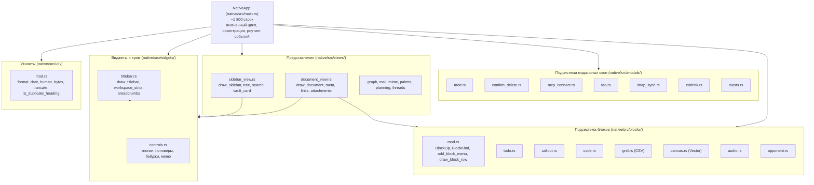

# Декомпозиция монолита main.rs и модульная архитектура нативного клиента — Руководство для мейнтейнера

Данный документ содержит исчерпывающее техническое описание модульного рефакторинга и декомпозиции монолитного файла `native/src/main.rs`, выполненных в ветке `refactor/decompose-main` нативного клиента CapsuleCraft / CapsuleOS.

---

## 1. Предпосылки и причины рефакторинга (Motivation & Pain Points)

До проведения рефакторинга кодовая база нативного клиента (`native/src/main.rs`) представляла собой классический монолит объемом **более 6 870 строк кода** (на момент старта ветки — 6 494 строки). 

В одном файле одновременно находились 7 разнородных предметных областей:
1. **Блочный движок контента:** отрисовка и редактирование интерактивных блоков (Todo, Callout, Code, табличный Grid с CSV, векторный Canvas с геометрией, Audio-плеер, Opponent/Debate).
2. **Модальные окна:** 6 модальных окон (`ConfirmDelete`, `McpConnect`, `Faq`, `ImapSync`, `CoThink`, всплывающие Toast-уведомления).
3. **Боковая панель и навигация:** карточка хранилища, семантический и лексический BM25-поиск, иерархическое дерево страниц с Drag-and-Drop, контекстные действия.
4. **Просмотр и редактирование документа:** рендеринг документа, метаданные (теги, статус, дата, размер), панель двусторонних ссылок (backlinks, related pages), редактор бинарных вложений в MIME.
5. **Двухуровневая шапка (Two-Tier Chrome):** системный Titlebar первого уровня и рабочая лента Workspace Strip второго уровня, хлебные крошки.
6. **Дизайн-система и контролы:** кнопки, шевроны, чипы тегов, меню, поповеры, бейджи.
7. **Утилиты форматирования:** расчёт байт, форматирование дат, санитизация MIME/CID, определение дубликатов заголовков.

### Ключевые проблемы монолитной структуры:
* **Перегрузка контекста при разработке:** любая попытка внедрения новой функциональности (например, rich-text WYSIWYG-редактора) неизбежно сталкивалась с редактированием файла в 6 800+ строк, создавая риски коллизий и диффов на тысячи строк.
* **Высокая когнитивная сложность и связанность:** методы диспетчеризации модалок и блоков были напрямую размазаны по структуре `NativeApp`, прокидывая приватные поля во все вспомогательные функции.
* **Затрудненный код-ревью и аудит:** изменения в логике таблицы или аудио-блока требовали модификации того же файла, где живет цикл событий `eframe::App::update`.

---

## 2. Цели и критерии успеха (Definition of Done)

* **Сокращение размера `main.rs`:** уменьшение объема с ~6 500 до **~1 800 строк** (сокращение на 70%+).
* **Строгая доменная изоляция:** разделение монолита на независимые модули по принципу единственной ответственности (SRP).
* **100% сохранение функциональности и контрактов:** нулевая регрессия пользовательского опыта, горячих клавиш и поведения UI.
* **100% прохождение тестов:** команда `cargo test --manifest-path native/Cargo.toml -j 1` обязана завершаться с кодом 0 и нулевым числом упавших тестов.
* **Чистая сборка релиза:** успешная сборка `cargo build --manifest-path native/Cargo.toml --release -j 1`.

---

## 3. Новая модульная архитектура (Modular Architecture)



---

## 4. Описание выделенных подсистем

### 4.1. Блочный движок контента (`native/src/blocks/`)
Вся логика работы со структурированными блоками документа вынесена в изолированный модуль:
* **`mod.rs`**: определяет протокол взаимодействия через enum `BlockOp`:
  ```rust
  pub enum BlockOp {
      None,
      Delete,
      MoveUp,
      MoveDown,
      InsertBelow(String),
  }
  ```
  Содержит меню добавления блоков `add_block_menu`, единую точку входа `draw_block_row` и диспетчер `draw_block_content`.
* **`grid.rs`**: автономный табличный блок с поддержкой парсинга и сериализации RFC 4180 CSV (`parse_csv`, `to_csv`), расчетом ширин колонок и тестами.
* **`canvas.rs`**: векторный холст с фигурами, соединительными линиями, расчетом стрелок и локальным сохранением выделения через `egui::Id`.
* **`code.rs`, `callout.rs`, `todo.rs`, `audio.rs`, `opponent.rs`**: легковесные специализированные модули для каждого типа блока.

### 4.2. Модальные окна и тосты (`native/src/modals/`)
Все модальные диалоги вынесены из тела `NativeApp` в независимые функции, возвращающие типизированные действия (Action-паттерн):
* **`confirm_delete.rs`**: возвращает `ConfirmDeleteAction { confirmed: bool, cancelled: bool }`.
* **`mcp_connect.rs`**: возвращает `McpModalAction` (добавление, сохранение, удаление конфигурации MCP).
* **`imap_sync.rs`**: возвращает `ImapModalAction` (сохранение конфига, запуск синхронизации, тестирование соединения).
* **`cothink.rs`**: возвращает `CoThinkModalAction` (запуск ИИ-сессии, сохранение заметки).
* **`faq.rs`**: автономное окно справки.
* **`toasts.rs`**: визуализация всплывающих уведомлений в правом нижнем углу.

### 4.3. Боковая панель (`native/src/views/sidebar_view.rs`)
Включает в себя всю навигационную структуру:
* `draw_sidebar`: главный цикл рендеринга сайдбара с фиксированным заголовком и подвалом.
* `vault_switcher` и `vault_card`: компактный и карточный переключатели хранилища.
* `search_box`: поле быстрого поиска с подсветкой синтаксиса и очисткой.
* `draw_page_nodes`: рекурсивная отрисовка дерева заметок с поддержкой раскрытия/сворачивания и Drag-and-Drop.
* `draw_search_row`: отрисовка результатов ранжирования BM25 с подсветкой совпадений и сниппетами контекста.

### 4.4. Документ, метаданные и вложения (`native/src/views/document_view.rs`)
Центральное представление документа:
* Определение типов взаимодействия `EditorAction` и `LinkContext`.
* `draw_document`: основной холст документа, заголовок H1, инлайн-хлебные крошки и рендеринг списка блоков.
* `document_meta`: строка метаданных (дата создания, теги с всплывающим редактором, бейдж статуса, размер).
* `links_panel`: двусторонние ссылки (исходящие `[[link]]`, входящие бэклинки, семантически близкие заметки).
* `attachments_editor`: автономный менеджер бинарных вложений (добавление через системный диалог `rfd`, удаление, расчет base64).
* `draw_empty_state`: приветственный экран для пустого хранилища.

### 4.5. Виджеты и дизайн-система (`native/src/widgets/`)
* **`titlebar.rs`**:
  - `draw_titlebar`: системный Titlebar (32 px) с кнопкой сайдбара, брендом, хранилищем, зоной перетаскивания окна, статусом синхронизации IMAP, утилитами и кнопками окна Windows.
  - `draw_workspace_strip`: рабочая полоса разделов (34 px) с 6 вкладками навигации и контекстными кнопками.
  - `draw_breadcrumbs`: хлебные крошки иерархии документа.
* **`controls.rs`**:
  - Полная палитра кнопок: `primary_button`, `secondary_button`, `text_button`, `icon_button`, `ghost`, `crumb_button`.
  - Элементы статуса и поповеров: `status_pill`, `tag_chip`, `popover_frame`, `info_popover`, `info_row`, `menu_header`, `menu_row`.

### 4.6. Вспомогательные утилиты (`native/src/util/mod.rs`)
* `folder_name`, `truncate_chars`, `truncate_to_width`.
* `format_date`, `format_date_long`, `human_bytes`, `status_label`, `now_nanos`.
* `is_duplicate_heading` + юнит-тест `test_duplicate_heading_detection`.

---

## 5. Метрики «До и После» (Before vs After)

| Метрика | До рефакторинга | После рефакторинга | Динамика |
| :--- | :---: | :---: | :---: |
| **Размер `native/src/main.rs`** | **6 494 строки** | **1 801 строка** | **-72.3% (-4 693 строки)** |
| **Количество модулей в `native/src/`** | 20 | 25 | +5 новых структурированных подсистем |
| **Изолированность блочного движка** | 0% (все в `main.rs`) | 100% (`native/src/blocks/`) | 8 независимых файлов |
| **Изолированность модалок** | 0% (все в `main.rs`) | 100% (`native/src/modals/`) | 7 независимых файлов |
| **Тесты воркспейса (`cargo test -j 1`)** | 102 passed | **104 passed, 0 failed** | +2 новых юнит-теста |
| **Сборка релиза (`cargo build --release -j 1`)** | Успешно | **Успешно (0 ошибок)** | Без изменения бинарных контрактов |

---

## 6. Рекомендации для мейнтейнеров по дальнейшей разработке

1. **Добавление нового блока контента:**
   - Создайте файл `native/src/blocks/<my_block>.rs`.
   - Реализуйте функцию `pub fn draw_<my_block>_block(ui: &mut Ui, block: &mut Value, locale: Locale) -> bool`.
   - Зарегистрируйте в `native/src/blocks/mod.rs` в enum `BlockKind` и вызове `draw_block_content`.
   - *Файл `main.rs` модифицировать не требуется!*

2. **Добавление нового модального окна:**
   - Создайте файл `native/src/modals/<my_modal>.rs`.
   - Спроектируйте функцию отображения, возвращающую действие (enum или struct Action).
   - Зарегистрируйте модуль в `native/src/modals/mod.rs`.
   - В `main.rs` добавьте только вызов в соответствующую ветку `NativeApp::update`.

3. **Разработка Rich-Text редактора:**
   - Теперь интеграция текстового WYSIWYG-движка локализована исключительно в `native/src/views/document_view.rs` (или как отдельный блок в `blocks/`), не затрагивая остальной шелл приложения.

4. **Регламент верификации изменений:**
   - Всегда компилировать и тестировать с флагом `-j 1`:
     ```powershell
     cargo check --manifest-path native/Cargo.toml -j 1
     cargo test --manifest-path native/Cargo.toml -j 1
     cargo build --manifest-path native/Cargo.toml --release -j 1
     ```
