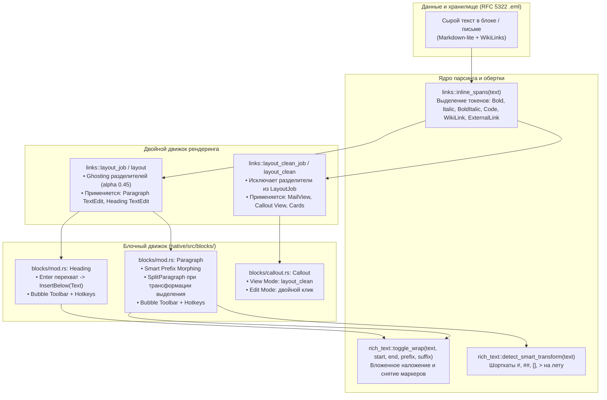

# Богатый текстовый редактор и инлайн-разметка (Native Rich-Text Editor) — Руководство для мейнтейнера

Данный документ содержит полное архитектурное описание подсистемы визуального форматирования текста (In-place WYSIWYG / Typora-style inline formatting), чистого рендеринга (0% сырых тегов разметки) и блочной модели текстовых элементов в нативном клиенте CapsuleCraft / CapsuleOS.

---

## 1. Архитектурная концепция и цели (Vision & Principles)

В ранних версиях приложения редактирование текста представляло собой обычный многострочный ввод сырого Markdown с ручным набором тегов (`**жирный**`, `_курсив_`, `[[ссылка]]`). При этом в режиме просмотра писем или карточек пользователь сталкивался с визуальным шумом: служебные теги `###`, `**` и квадратные скобки оставались видны на экране.

### Ключевые принципы новой архитектуры:
1. **0% сырых тегов в режиме чтения (Clean Rendering):** 
   В окне просмотра писем (`MailView`), карточках заметок (`Callout`), аналитике Co-Thinker и неактивных блоках служебные символы синтаксиса `**`, `_`, `*`, `` ` ``, `[[`, `]]`, `](url)` полностью исключаются из текстового потока `egui::text::LayoutJob`. Пользователь видит только оформленный контент (жирный, курсив, моноширинный код, аккуратные ссылки).
2. **In-place Typora-style редактор (Inline Ghosting):** 
   Внутри активного поля редактирования (`TextEdit`) разделители не скрываются слепо (что приводило бы к рассинхронизации каретки ввода `egui`), а стилизуются полупрозрачным приглушенным цветом (`theme::FAINT`, прозрачность 45%). Сам форматируемый фрагмент сразу отображается жирным, наклонным или моноширинным шрифтом.
3. **Бесконфликтная вложенность стилей:** 
   Жирный и курсивный текст используют раздельные токены (`**` для bold, `_` для italic). Алгоритм `toggle_wrap` поддерживает многослойное наложение и изолированное снятие стилей (`**_жирный курсив_**` $\rightarrow$ снятие bold $\rightarrow$ `_курсив_`).
4. **Контекстный плавающий тулбар (Notion-style Bubble Bar):** 
   При выделении текста в параграфе или заголовке над выделением плавно всплывает тулбар с быстрыми действиями: `[ B ]`, `[ I ]`, `[[ ]]`, а также меню «Turn into…».

---

## 2. Диаграмма взаимодействия компонентов



---

## 3. Детальное описание подсистем

### 3.1. Токенизатор и рендерер разметки (`native/src/links.rs`)

Файл расширен структурированным токенизатором `inline_spans`:
```rust
#[derive(Clone, Debug, PartialEq, Eq)]
pub enum InlineKind {
    BoldItalic,
    Bold,
    Italic,
    Code,
    WikiLink,
    ExternalLink { label_len: usize },
}

#[derive(Clone, Debug, PartialEq, Eq)]
pub struct InlineSpan {
    pub start: usize,
    pub end: usize,
    pub delim_start_len: usize,
    pub delim_end_len: usize,
    pub kind: InlineKind,
}
```

* **Безопасность UTF-8:** Парсер работает по символьным итераторам и вызовам `starts_with`, гарантируя отсутствие паник на кириллических многобайтовых символах.
* **Функции генерации:**
  - `layout_job(text, size, wrap) -> LayoutJob`: формирует `LayoutJob` для редактора. Делимитеры рендерятся моноширинным уменьшенным шрифтом в цвете `theme::fade(theme::FAINT, 0.45)`.
  - `layout_clean_job(text, size, wrap) -> LayoutJob`: формирует чистый `LayoutJob` для режима просмотра. Служебные токены вообще не добавляются в `job.text`.
  - Обертки `layout(ui, ...)` и `layout_clean(ui, ...)` вызывают `ui.painter().layout_job(...)` и возвращают `Arc<Galley>`.

---

### 3.2. Автономный модуль интерактивного редактора (`native/src/rich_text.rs`)

Модуль инкапсулирует всю математику работы с выделениями и плавающими элементами:

* **`SavedSelection`**: структура, сохраняющая экранный прямоугольник (`Rect`) и байтовые границы (`b_start..b_end`) выделения в `ui.data()` между кадрами. Это решает классическую проблему `egui`: когда пользователь кликает по кнопке плавающего тулбара, текстовое поле теряет фокус, но сохраненное состояние позволяет применить форматирование именно к нужному диапазону байт.
* **`toggle_wrap(text, start, end, prefix, suffix)`**:
  - Распознает 4 сценария:
    1. Снятие стиля из комбинированной вложенности (например, снятие `**` из `**_мир_**` оставляет `_мир_`);
    2. Прямое снятие стиля, если само выделение начинается и заканчивается на маркер;
    3. Снятие стиля, если маркеры находятся непосредственно снаружи выделения;
    4. Оборачивание выделения в новые маркеры.
  - Автоматически выравнивает индексы по UTF-8 границам символов.
* **`detect_smart_transform(text)`**: анализирует первую строку на ввод Markdown-префиксов:
  - `# `, `## `, `### ` $\rightarrow$ заголовок соответствующего уровня;
  - `[] `, `- [ ] `, `* [ ] ` $\rightarrow$ чекбокс задачи;
  - `> ` $\rightarrow$ блок цитаты/заметки (Callout);
  - ` ``` ` $\rightarrow$ блок кода.
* **`draw_bubble_toolbar(ui, menu_id, selection_rect, locale)`**:
  - Отрисовывает аккуратный темный поповер над выделенным фрагментом с кнопками `[ B ]`, `[ I ]`, `[[ ]]` и селектором «Type ▲/▼».

---

### 3.3. Блочный движок и операции над структурой (`native/src/blocks/mod.rs`)

Enum `BlockOp` расширен операциями динамической модификации структуры заметки:
```rust
#[derive(Clone, Debug, PartialEq, Eq)]
pub enum BlockOp {
    Up,
    Down,
    Delete,
    SetLevel(u8),
    TransformTo(BlockKind),
    InsertBelow(BlockKind, String),
    SplitParagraph {
        before: String,
        target_kind: BlockKind,
        target_level: Option<u8>,
        target_text: String,
        after: String,
    },
}
```

* **Автопереход по `Enter` в заголовке:**
  ```rust
  if text.contains('\n') || text.contains('\r') {
      let mut lines = text.splitn(2, |c| c == '\n' || c == '\r');
      let first = lines.next().unwrap_or("").to_string();
      let rest = lines.next().unwrap_or("").to_string();
      set_block_text(block, first);
      *op = Some(BlockOp::InsertBelow(BlockKind::Text, rest));
      return true;
  }
  ```
* **Разделение параграфа при трансформации выделения (`SplitParagraph`):**
  Если пользователь выделил фразу в середине абзаца и выбрал «H2», параграф разделяется на 3 блока: абзац до выделения, заголовок H2 и абзац после выделения. Если выделен весь абзац, выполняется простая замена через `TransformTo`.
* **Универсальная функция `transform_block`:**
  Извлекает текст из любого типа блока (`data.text`, `data.content`, `data.code` или объединение элементов `data.items`) и пересобирает блок в целевой тип без потери пользовательских данных.

---

### 3.4. Адаптация представлений (`native/src/views/`)

* **`document_view.rs`**:
  - Обрабатывает `BlockOp::InsertBelow` через `capsule.blocks.insert(index + 1, ...)`.
  - Обрабатывает `BlockOp::SplitParagraph` через `capsule.blocks.splice(index..=index, new_blocks)`.
* **`mail_view.rs`**:
  - В секции `native_body` блоки `paragraph` и `callout` выводятся через `links::layout_clean`, исключая показ Markdown-синтаксиса в письмах.
* **`blocks/callout.rs`**:
  - Поддерживает двойной клик для входа в редактирование. В режиме просмотра использует `links::layout_clean` и стилизует вложенные маркеры списков (`•`, `1.`) акцентным цветом карточки.

---

## 4. Рекомендации для мейнтейнеров по дальнейшему развитию

1. **Добавление нового инлайн-маркера (например, `~~зачеркнутый~~` или `==маркер==`):**
   - Добавьте вариант в enum `InlineKind` в `native/src/links.rs`.
   - В `inline_spans` зарегистрируйте проверку префикса и закрывающего символа.
   - В `layout_job` добавьте ветку с полупрозрачными маркерами и цветом/перечеркиванием (`strikethrough: Stroke`).
   - В `layout_clean_job` добавьте добавление только внутреннего текста без маркеров.
   - В `rich_text::draw_bubble_toolbar` добавьте кнопку на тулбар при необходимости.

2. **Добавление нового типа блока в меню «Turn into…»:**
   - В `rich_text::draw_bubble_toolbar` добавьте пункт в выпадающий список `menu_item(ui, "badge", "Label")`.
   - В `blocks/mod.rs` в сопоставлении `BubbleAction::TransformBlock(t_name)` сопоставьте имя с соответствующим `BlockKind`.
   - В `transform_block` добавьте ветку сборки JSON структуры нового блока.

3. **Регламент верификации изменений:**
   - Всегда запускайте тесты с флагом `-j 1`:
     ```powershell
     cargo test --manifest-path native/Cargo.toml -j 1
     ```
   - Запуск релизной компиляции:
     ```powershell
     cargo build --manifest-path native/Cargo.toml --release -j 1
     ```
